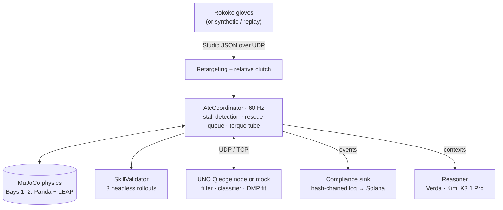
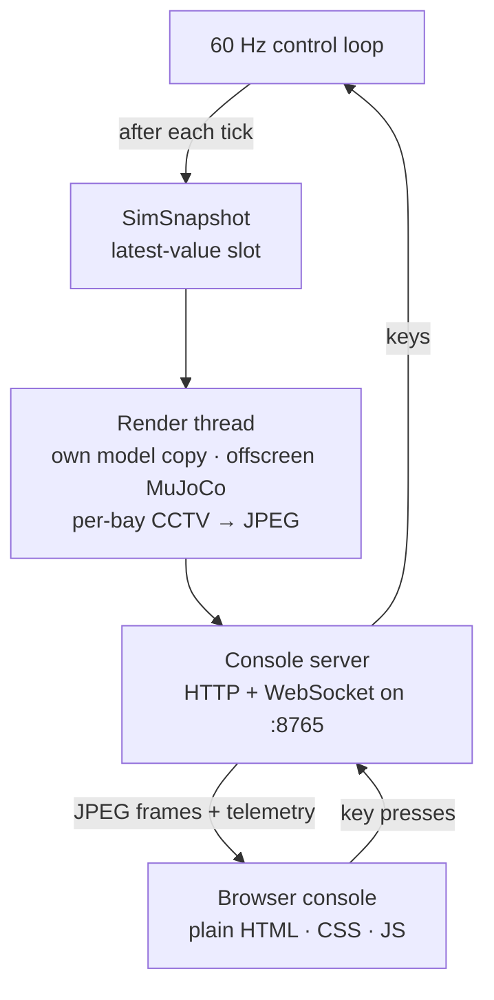
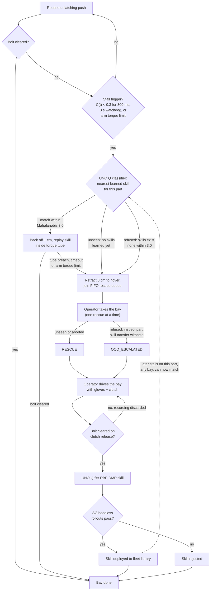

# Air Traffic Control for Robot Hands

A fleet supervisor for EV-battery disassembly. Four MuJoCo bays run Franka Panda arms with LEAP
hands that unlatch a sprung slide-bolt latch. When a bay stalls, an operator rescues it with
Rokoko gloves. An Arduino UNO Q (or a local mock) learns the rescue as a skill, a headless
simulation gate checks it, and the fleet reuses it. The pipeline also has a compliance chain
and an LLM reasoning co-pilot (Kimi K3.1 Pro on Verda).

See `PROJECT_BRIEF.md` for the pitch and
`docs/superpowers/specs/2026-11-14-atc-fleet-rescue-design.md` for the design.

## How it works

Everything runs locally on the laptop in one Python process. The only exception is an
optional real UNO Q board on the network. MuJoCo does all the physics and all the 3D rendering.
The browser is only a display and a keyboard.

**Control loop.** Glove input drives a 60 Hz MuJoCo loop. Compliance and reasoning run on
background threads and never block it. The UNO Q calls (classify a stall, fit a skill) are short
request/response calls. The 3-rollout validation gate runs inline after a rescue and takes about
2 s.



**Display pipeline.** After every tick the loop drops a snapshot. A separate render thread draws
the camera feeds from it, and the browser only shows the resulting images.



The UNO Q, compliance sink and reasoner fall back to local modes when unavailable. Bays 3–4
replay a canned background cycle rather than running live physics.

How a bay handles a stall (Bays 1 and 2, coordinator in `src/teleop/atc/coordinator.py`):



Both unseen and refused stalls go to a human through the same queue. The difference:

- **Unseen** (`STALL_ALERT`): nothing is learned yet, so the bay asks to be taught.
- **Refused** (`OOD_REFUSAL`): skills exist, but none is close enough, so the robot will not
  guess. This is the negative control. A pinned bolt cannot be cleared by hand either, so
  nothing is learned from it.

### A rescue, step by step

1. **Routine.** Bays 1 and 2 run a routine one-finger push to unlatch the slide-bolt.
2. **Stall.** A fault (a jammed flap or a pinned bolt) triggers a stall. The trigger is the
   confidence C(t) staying below 0.3 for 300 ms, a 3 s watchdog, or an arm torque limit. The
   coordinator judges this from contact only (bolt travel, external torque, wrist speed). It
   never reads the fault state directly.
3. **Classify.** The UNO Q compares the stall signature with the skills learned for this part.
   - **Match (Mahalanobis distance 3.0 or less):** the bay replays the skill inside a torque
     safety tube. If the tube is breached or the skill times out, the bay goes to the rescue
     queue instead.
   - **Unseen (no skills learned yet):** the bay retracts to a safe hover and joins the rescue
     queue.
   - **Refused (skills exist, none within 3.0):** the bay also joins the rescue queue, flagged
     `OOD_ESCALATED`. The robot will not apply a skill it has not validated for this stall.
4. **Rescue.** The queue hands the operator one bay at a time. The operator holds the clutch,
   and the gloves drive that bay's wrist and fingers while the rescue is recorded. If the bolt is
   not cleared on clutch release, the recording is discarded and the operator can try again.
5. **Learn.** The UNO Q fits the recording as a dynamic movement primitive (a learned movement
   skill) in under 20 ms. `SkillValidator` replays it in three perturbed headless simulations,
   and it is added to the fleet library only if all three pass.
6. **Reuse.** Bay 2, with a rotated and shifted latch, clears the same jam on its own with the
   skill warped into its frame. The pinned-bolt negative control is refused.
7. **Record and explain.** Every step emits compliance events (a signed, hash-chained log,
   optionally anchored on Solana). It also sends reasoning requests to Kimi, which writes the
   operator guidance and audit rationale shown in the console. Neither one can block the 60 Hz
   loop. If they are offline, they fall back to local output.

### Display modes

- **Browser console (default).** The MuJoCo render thread produces fixed CCTV-style feeds plus a
  fleet dashboard. The browser shows the feeds as streamed JPEG images. It does not render 3D
  itself.
- **MuJoCo viewer (`--display viewer`).** MuJoCo's own interactive 3D window with a text HUD.
  You can orbit the camera and inspect contacts. The simulation is identical.
- **Headless (`--headless`).** No rendering. Used for CI and quick checks.

## Tech stack

| Layer | Technology |
|---|---|
| Language and tooling | Python 3.12, [uv](https://docs.astral.sh/uv/), ruff, pyright (strict), pytest + hypothesis |
| Physics and rendering | [MuJoCo](https://mujoco.org/) 4: physics, offscreen `mujoco.Renderer` for console feeds, passive viewer |
| Robots | Franka Panda and LEAP Hand (16-DoF) from MuJoCo Menagerie, a custom sprung slide-bolt latch (MJCF) |
| Control | Damped least-squares differential IK, `mj_inverse` external-torque estimation, NumPy |
| Glove input | Rokoko Smartglove II via Rokoko Studio custom streaming (JSON v3 over UDP) |
| Edge device | Arduino UNO Q: the Python service on its Linux side (UDP stream + TCP ops), the STM32 MCU sketch for the operator console. A loopback mock runs in-process without the board |
| Skill learning | 1-Euro filter, Mahalanobis classifier, 30-kernel RBF dynamic movement primitives |
| Compliance | SHA-256 hash-chained JSONL log, Ed25519 signatures, Solana Memo anchoring (`solders`) |
| Reasoning | Verda Inference API (OpenAI-compatible chat completions), model `kimi-k3-1-pro`, stdlib `urllib` |
| Ops console | Plain HTML/CSS/JS (no framework, no three.js, no CDN), 2D `<canvas>` sparklines, `websockets` server, Pillow JPEG encoding |
| Datasets (original pipeline) | LeRobot dataset format (`train` dependency group) |

Code map:

| Path | Contents |
|---|---|
| `src/teleop/atc/` | Coordinator, stage script and keys, text HUD, skill validator |
| `src/teleop/sim/` | Scene and bay builders, latch, IK, torque estimator, fixed-rate loop |
| `src/teleop/console/` | Snapshot, render worker, telemetry adapter, server, `web/` front end |
| `src/teleop/unoq/` | Edge service: filter, classifier, DMP, client/server, MCU bridge |
| `src/teleop/compliance/` | Compliance sink protocol and the Solana implementation |
| `src/teleop/reasoning/` | Reasoner protocol and the Verda (Kimi) implementation |
| `src/teleop/input/`, `retarget/`, `wrist/` | Glove sources, retargeting, relative clutch, wrist tracking |
| `src/teleop/commands/` | `teleop` subcommands |

## Setup

You need [uv](https://docs.astral.sh/uv/). It installs Python 3.12 for you.

```bash
uv sync --all-extras --all-groups      # dependencies, dev tools and optional groups
uv run python scripts/fetch_models.py  # Panda/LEAP models into third_party/ (needed for the sim)
cp .env.example .env                   # then fill in what you need (see below)
```

Do this in every new git worktree. Worktrees do not share `third_party/` or `.env`.

### `.env`

`.env` is gitignored. Never commit it. Every service falls back to a local or offline mode when
its keys are unset, so the demo runs with an empty `.env`.

| Variable | Purpose | If unset |
|---|---|---|
| `VERDA_API_KEY` | Verda **Inference API** key (not the Cloud API client ID/secret) | Built-in deterministic reasoner text |
| `VERDA_BASE_URL` | `https://inference.verda.com/v1` | That default |
| `NEMOTRON_MODEL` | `kimi-k3-1-pro` (the variable name is historical) | That default |
| `SOLANA_RPC_URL`, `SOLANA_KEYPAIR_PATH` | Compliance chain | Local hash-chained audit log |
| `UNOQ_HOST`, `UNOQ_PORT`, `UNOQ_SERIAL_PORT` | Real UNO Q edge node | In-process loopback mock |
| `HOTSPOT_PASSWORD` | Laptop hotspot for the gloves (Windows) | Only needed with `--hotspot` |

Kimi must be enabled for your project in the Verda Console under Inference. Otherwise requests
return `subscription_required` and the reasoner quietly uses its offline text.

## Run the demo

Run everything from the repo root.

| What | Command |
|---|---|
| Scripted demo in the browser ops console (default) | `uv run teleop atc --source synthetic --script` |
| Scripted demo in the MuJoCo window | `uv run teleop atc --source synthetic --script --display viewer` |
| Drive it yourself with the keyboard | `uv run teleop atc --source synthetic` |
| Headless check (exits 0 only if all 6 beats pass) | `uv run teleop atc --source synthetic --headless --script --no-audio` |
| With the real gloves (start Rokoko Studio streaming first) | `uv run teleop atc --source studio --script` |

The console is served at <http://127.0.0.1:8765/> and opens in your browser.

The `--script` run plays six stage beats: routine autonomy, a fault and contact stall, the
operator rescue, the edge skill fit and 3-rollout sim gate, Bay 2 pose generalization, and the
negative control (refused).

### Keys

These work in the console page or the MuJoCo window.

| Key | Action |
|---|---|
| `1`–`4` | Select a bay |
| `SPACE` | Toggle the clutch (rescue) |
| `F` | Arm the Bay 1 flap jam (causes a contact stall) |
| `G` | Arm the Bay 2 flap jam |
| `P` | Arm the Bay 2 pinned bolt (out-of-distribution, refused) |
| `R` | Reset |

A typical manual run:

1. Press `F` and wait for Bay 1 to stall and queue.
2. Press `1`, then `SPACE`, to rescue it.
3. Watch the skill fit, the 3/3 gate and Bay 2 clearing itself.
4. Press `P` to see the refusal.

### Useful flags

| Flag | Effect |
|---|---|
| `--display console\|viewer` | Browser ops console (default) or the MuJoCo passive viewer |
| `--no-browser` | Print the console URL instead of opening it |
| `--console-port N`, `--console-fps N` | Console server port and feed frame rate |
| `--no-audio` | No spoken or audio cues |
| `--no-background` | Leave out background Bays 3 and 4 (lighter) |
| `--unoq-host IP` / `--serial-port PORT` | Use the real UNO Q instead of the mock |
| `--hotspot` | Keep the laptop hotspot up for the gloves |
| `--env-file PATH` | Read a different `.env` |
| `--config PATH` | Stage config (`configs/atc.yaml`) |

## Other tools

| Command | What it does |
|---|---|
| `uv run python -m teleop.reasoning.nemotron status` | Show reasoner mode, endpoint and model |
| `uv run python -m teleop.reasoning.nemotron demo` | Send three sample events to Kimi |
| `uv run python scripts/console_preview.py` | Ops console with fake telemetry, no MuJoCo |
| `uv run teleop unoq --serve` | Run the UNO Q edge service on its own |
| `uv run teleop sim` | Original two-hand lift-cube teleop scene |
| `uv run teleop calibrate` / `record` / `replay` / `process` | Glove calibration and LeRobot dataset pipeline |
| `uv run teleop hotspot {up,status,down,watch}` | Laptop hotspot control (Windows) |

Every command takes `--help`.

The reasoner `demo` is working when each result shows `(kimi-k3-1-pro, ~2000 ms)`. If it shows
`placeholder:...`, the key is missing or Kimi is not enabled.

## Troubleshooting

- **`... panda_nohand.xml missing`**: run `uv run python scripts/fetch_models.py`.
- **MuJoCo window misbehaves on Wayland**: prefix the command with `GLFW_PLATFORM=x11`.
- **Reasoner stays `offline`**: `VERDA_API_KEY` is not being read. Run from the repo root or
  pass `--env-file`.
- **`pyright` reports missing `lerobot`**: run `uv sync --all-extras --all-groups`.

## Contributing

Read `CLAUDE.md` and `CONTRIBUTING.md` first. In short:

1. Claim a task: `uv run task list --ready`, then `uv run task claim T-NNN --agent <you>`.
2. Use one worktree per task, on a `<type>/<kebab-summary>` branch.
3. Run the checks below before every PR.
4. Use Conventional Commits.
5. Never push to `main`.

```bash
uv run ruff check . && uv run ruff format --check . && uv run pyright && uv run pytest
```
