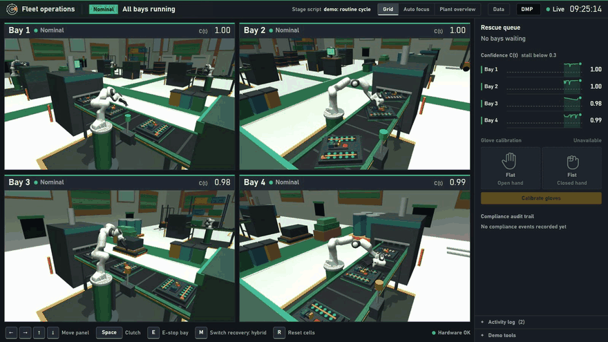
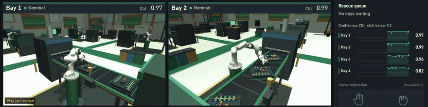
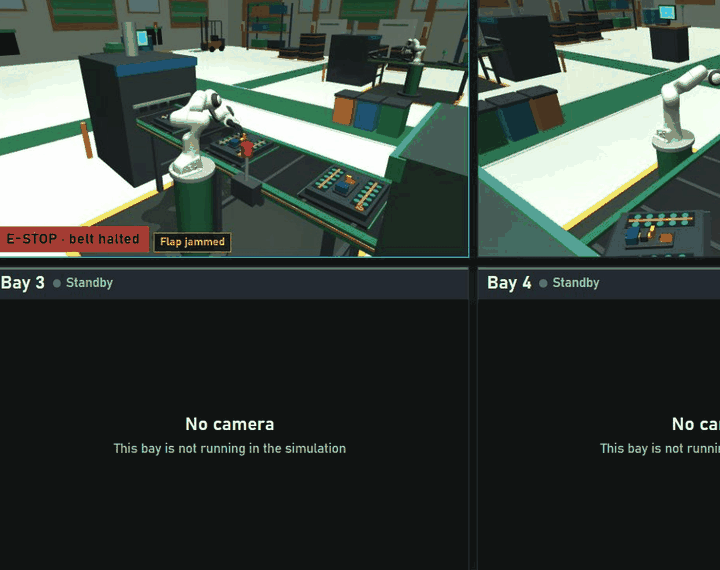

# Air Traffic Control for Robot Hands



A fleet supervisor for EV-battery disassembly. Four MuJoCo bays run Franka Panda arms with LEAP
hands that unlatch a sprung slide-bolt. When a bay stalls, an operator rescues it with Rokoko
gloves, an Arduino UNO Q (or a local mock) learns the rescue as a skill, a validation gate checks
it, and the whole fleet reuses it.

**Why.** Unlatching EV battery modules needs two fingers at once: the thumb holds a sprung
safety flap down while the index slides a retention bolt. Two-finger grippers can't do it, and
autonomous dexterous hands stall whenever a part arrives jammed. Following fleet-learning work
(HG-DAgger, Fleet-DAgger), one technician supervises many robots and only steps in on the
stalls, and each rescue teaches the whole fleet.

## How it works

**1. Stall.** A jammed flap stops the bolt. The coordinator spots it from contact alone
(confidence C(t) below 0.3 for 300 ms, a 3 s watchdog, or an arm torque limit), retracts to a
safe hover and queues the bay for a human.



**2. Rescue.** The operator selects the bay and holds the clutch. The gloves drive the wrist
and fingers: the thumb presses the flap flat while the wrist pushes the bolt clear.



**3. Learn and gate.** The UNO Q fits the recording as a DMP skill in under 20 ms. It is only
shared with the fleet if 18 of 20 randomized sim rollouts pass (plus an optional Gemini grasp
check, see [`docs/copilot.md`](docs/copilot.md)).

**4. Reuse.** The next stall on that part, on any bay, is matched to the skill (Mahalanobis
distance ≤ 3.0) and cleared autonomously inside a torque safety tube. Stalls that match nothing
(e.g. a pinned bolt) are refused and go back to the operator.

Everything runs in one local Python process at 60 Hz. Gemini, Solana and the real UNO Q are
optional: each falls back to an offline mode when unconfigured.

### Details

- **The latch.** Three MuJoCo box primitives: a base track, a sliding bolt and a sprung stopper
  flap. In the jammed state a hinge spring pushes the flap up into the bolt path, so clearing it
  takes real contact physics (thumb holds the flap down against the spring while the bolt
  slides past).
- **The robots.** Bays 1-2 run full physics: a 7-DoF Franka Panda with a 16-DoF LEAP hand,
  driven by damped-least-squares differential IK. Bays 3-4 replay a lightweight background cycle.
- **Stall detection.** Confidence combines the external joint torque (from `mj_inverse`) and
  the velocity shortfall:
  `C(t) = exp(-α·‖τ_ext‖∞/τ_limit − β·max(0, v_cmd − v_act)/v_nom)`.
  The robot never sees the flap state; it only finds a jam through contact.
- **Teleop.** Rokoko Smartglove II data is retargeted to the LEAP hand. A relative clutch
  re-indexes the operator's hand on every press, so they work from a comfortable rest pose. One
  rescue at a time (FIFO queue), and releasing the dead-man clutch freezes the arm and discards
  the partial recording.
- **Edge learning on the UNO Q.** The Linux side filters the glove stream (One-Euro), classifies
  the stall signature `z = [bolt position at stall, Δτ_ext]` with a Mahalanobis classifier, and
  fits a 30-kernel RBF DMP by ridge regression. The wrist path is stored in the latch frame and
  the finger joints are phase-locked to it. The MCU side reads the bay buttons, clutch and
  e-stop at 1 kHz and drives an 8×13 LED status grid.
- **Generalization.** Bay 2's latch is rotated about 35° and shifted 12 cm. The skill is warped
  into that frame through IK and replays without retraining.
- **Safety.** Autonomous replay stays inside a torque tube around the demonstration
  (`‖τ_ext − τ_demo‖∞ ≤ τ_margin`) with a hard torque ceiling. A pinned bolt produces an unseen
  signature and is refused (the negative control).
- **Gate.** 20 headless rollouts randomize latch pose, sensor error, flap stiffness and friction;
  18 must pass. With `GEMINI_API_KEY` set, a Gemini grasp check on three rescue keyframes must
  also approve, and the verdict is spoken.
- **Audit.** Every step is written to a hash-chained, Ed25519-signed log, optionally anchored on
  Solana.

## Setup

Needs [uv](https://docs.astral.sh/uv/) (it installs Python 3.12).

```bash
uv sync --all-extras --all-groups      # dependencies and dev tools
uv run python scripts/fetch_models.py  # Panda/LEAP models into third_party/
cp .env.example .env                   # optional keys, the demo runs with it empty
```

Repeat in every git worktree (`third_party/` and `.env` are not shared).

| `.env` variable | Purpose | If unset |
|---|---|---|
| `GEMINI_API_KEY`, `COPILOT_LOCAL_URL` | Voice cues, grasp gate, audit | Physics-only gate |
| `UNOQ_HOST`, `UNOQ_PORT`, `UNOQ_SERIAL_PORT` | Real UNO Q board | In-process mock |
| `SOLANA_RPC_URL`, `SOLANA_KEYPAIR_PATH` | Compliance anchoring | Local hash-chained log |
| `HOTSPOT_PASSWORD` | Laptop hotspot for the gloves (Windows) | Hotspot off |

## Run

| What | Command |
|---|---|
| Booth: gloves, UNO Q, hotspot | `uv run teleop atc` |
| Scripted rescue, no hardware (the GIFs above) | `uv run teleop atc --source synthetic --demo-rescue` |
| Full 6-beat stage script | `uv run teleop atc --source synthetic --script` |
| Drive it yourself with the keyboard | `uv run teleop atc --source synthetic` |
| MuJoCo 3D viewer instead of the browser | add `--display viewer` |
| Headless CI check | `uv run teleop atc --source synthetic --headless --script --no-audio` |

The console opens at <http://127.0.0.1:8765/>. For the booth, start Rokoko Studio streaming
(custom JSON v3 to `127.0.0.1:14043`) and power the UNO Q first; see
[`firmware/unoq_app/README.md`](firmware/unoq_app/README.md) for the board.

### Keys

| Key | Action |
|---|---|
| `←` `→` `↑` `↓` / `1`–`4` | Select a bay |
| `SPACE` | Toggle the clutch (rescue) |
| `F` / `G` | Jam the Bay 1 / Bay 2 flap |
| `P` | Pin the Bay 2 bolt (out-of-distribution, refused) |
| `M` | Cycle recovery backend `dmp` → `hybrid` → `act` |
| `R` | Reset |

A manual run: press `F`, wait for Bay 1 to queue, press `1` then `SPACE` to rescue, `SPACE`
again once the bolt clears, then watch the gate and Bay 2 reuse the skill. Press `P` to see a
refusal. Without gloves, the clutch plays a scripted rescue.

Common flags: `--no-audio`, `--no-gemini`, `--no-background` (drop Bays 3-4), `--no-browser`,
`--no-hotspot`, `--seed N`. Run `uv run teleop atc --help` for the rest.

## ACT recovery policy

A matched stall is cleared by the DMP skill by default. An ACT policy trained on rescue
episodes can take over for the faults it has passed the gate on:

```bash
uv run teleop atc --headless --no-audio --generate 300 --seed 1 --record-episodes data/episodes/gen-001
uv run teleop process --in data/episodes/gen-001 --out data/episodes/gen-001-qc
# train: see docs/training/verda.md, then copy models/act/<run>/ back
uv run teleop eval --checkpoint models/act/<run> --dataset data/episodes/gen-001-qc   # writes gate.json
uv run teleop atc --recovery-backend hybrid --act-checkpoint models/act/<run>
```

`hybrid` uses ACT where its gate covers the stall and falls back to DMP; `act` sends uncovered
stalls to the operator.

## Code map

| Path | Contents |
|---|---|
| `src/teleop/atc/` | Coordinator, stage script, HUD, skill validator |
| `src/teleop/sim/` | Scene, latch, IK, torque estimator, fixed-rate loop |
| `src/teleop/console/` | Render worker, server and `web/` front end |
| `src/teleop/unoq/` | Edge service: filter, classifier, DMP |
| `src/teleop/copilot/` | Gemini voice, grasp gate, audit |
| `src/teleop/compliance/`, `reasoning/` | Solana compliance sink, offline triage |
| `src/teleop/input/`, `retarget/`, `wrist/` | Glove sources, retargeting, clutch |

Other commands: `teleop unoq --serve`, `teleop sim`, `teleop calibrate|record|replay|process`,
`teleop hotspot {up,status,down}`. All take `--help`.

## Troubleshooting

- **`panda_nohand.xml missing`**: run `uv run python scripts/fetch_models.py`.
- **MuJoCo window misbehaves on Wayland**: prefix with `GLFW_PLATFORM=x11`.
- **`pyright` reports missing `lerobot`**: run `uv sync --all-extras --all-groups`.

## Further reading

- [`PROJECT_BRIEF.md`](PROJECT_BRIEF.md): the full proposal, math and stage script
- [ATC design spec](docs/superpowers/specs/2026-11-14-atc-fleet-rescue-design.md)
- [ACT recovery policy spec](docs/superpowers/specs/2026-11-14-act-recovery-policy-design.md)
- [`docs/copilot.md`](docs/copilot.md): the Gemini voice, grasp gate and audit
- [`docs/training/verda.md`](docs/training/verda.md): training the ACT policy
- [`firmware/unoq_app/README.md`](firmware/unoq_app/README.md): the UNO Q board
- [ADRs](docs/adr/): architecture decisions

## Contributing

Read [`CLAUDE.md`](CLAUDE.md) and [`CONTRIBUTING.md`](CONTRIBUTING.md). Claim a task with
`uv run task list --ready`, work in a worktree on a `<type>/<kebab-summary>` branch, use
Conventional Commits, never push to `main`, and run before every PR:

```bash
uv run ruff check . && uv run ruff format --check . && uv run pyright && uv run pytest
```
