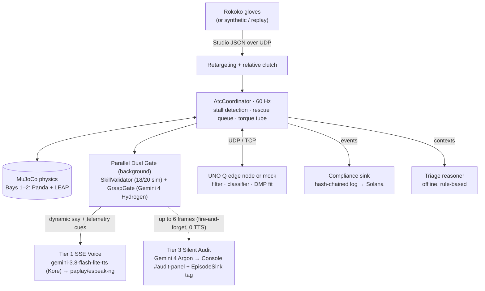
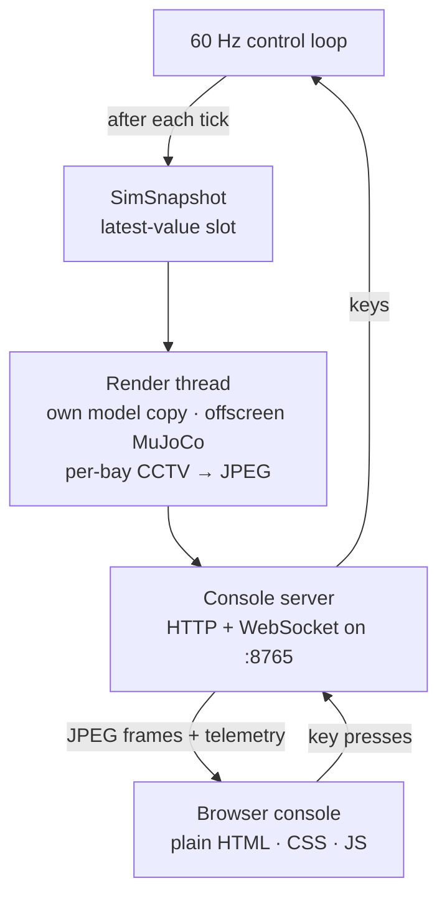
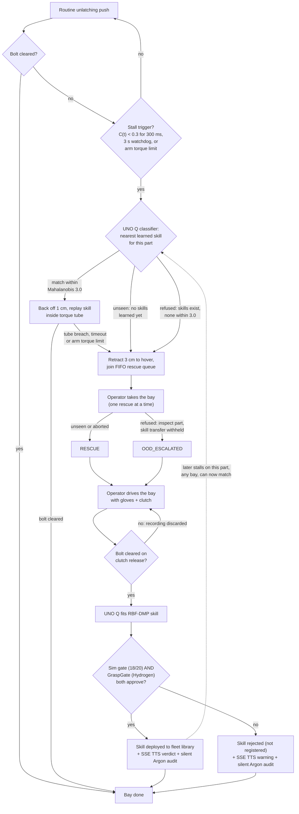

# Air Traffic Control for Robot Hands

A fleet supervisor for EV-battery disassembly. Four MuJoCo bays run Franka Panda arms with LEAP
hands that unlatch a sprung slide-bolt latch. When a bay stalls, an operator rescues it with
Rokoko gloves. An Arduino UNO Q (or a local mock) learns the rescue as a skill, a dual
validation gate (20 randomized headless simulation rollouts in parallel with a `gemini-4-hydrogen`
multimodal grasp check) approves it before deployment, and the fleet reuses it. A three-tier
Gemini copilot (`docs/copilot.md`) provides `<0.7 s` SSE-streamed voice cues
(`gemini-3.8-flash-lite-tts`, voice `Kore`), inline grasp gating (`gemini-4-hydrogen`), and silent
background engineering audits + ACT dataset tagging (`gemini-4-argon`), alongside a Solana
compliance chain.

See `PROJECT_BRIEF.md` for the pitch and
`docs/superpowers/specs/2026-11-14-atc-fleet-rescue-design.md` for the design.

## How it works

Everything runs locally on the laptop in one Python process. The only exception is an
optional real UNO Q board on the network. MuJoCo does all the physics and all the 3D rendering.
The browser is only a display and a keyboard.

**Control loop.** Glove input drives a 60 Hz MuJoCo loop. Validation, compliance, voice synthesis,
and deep auditing all run on background executors and never block the 60 Hz step. After a rescue
clears the bolt (`>= 5.2 cm`), the UNO Q fits an RBF-DMP skill (`< 20 ms`) and the coordinator's
background gate runs `SkillValidator` (20 randomized headless rollouts, `>= 18/20` required) **in
parallel with** `GraspGate` (`gemini-4-hydrogen`, `thinkingLevel="LOW"`, 3 `<= 512 px` rescue
keyframes + torque/bolt/HV clearance telemetry); both must approve before `unoq.register_skill`
deploys the skill, while Hydrogen's `"say"` verdict streams immediately via SSE
`gemini-3.8-flash-lite-tts` (`Kore`) and `gemini-4-argon` runs a silent fire-and-forget audit for
the console `#audit-panel` and ACT episode curation (`meta/teleop_episodes.jsonl`). With
`GEMINI_API_KEY` unset, `--no-gemini`, or `--headless`, gating falls back deterministically to
local Gemma (`COPILOT_LOCAL_URL`) or physics-only (`SkillValidator`).



**Display pipeline.** After every tick the loop drops a snapshot. A separate render thread draws
the camera feeds from it, and the browser only shows the resulting images.



The UNO Q, compliance sink and reasoner fall back to local modes when unavailable. Bays 3–4
replay a canned background cycle rather than running live physics.

How a bay handles a stall (Bays 1 and 2, coordinator in `src/teleop/atc/coordinator.py`):



Both unseen and refused stalls go to a human through the same queue. The difference:

- **Unseen** (`STALL_ALERT`): nothing is learned yet, so the bay asks to be taught.
- **Refused** (`OOD_REFUSAL`): skills exist, but none is close enough, so the robot will not
  guess. This is the negative control. A pinned bolt cannot be cleared by hand either, so
  nothing is learned from it.

### A rescue, step by step

1. **Routine.** Bays 1 and 2 run a routine one-finger push to unlatch the slide-bolt.
2. **Stall.** A fault (a jammed flap or a pinned bolt) triggers a stall. The trigger is the
   confidence C(t) staying below 0.3 for 300 ms, a 3 s watchdog, or an arm torque limit. The
   coordinator judges this from contact only (bolt travel, external torque, wrist speed). It
   never reads the fault state directly.
3. **Classify.** The UNO Q compares the stall signature with the skills learned for this part.
   - **Match (Mahalanobis distance 3.0 or less):** the bay replays the skill inside a torque
     safety tube. If the tube is breached or the skill times out, the bay goes to the rescue
     queue instead.
   - **Unseen (no skills learned yet):** the bay retracts to a safe hover and joins the rescue
     queue.
   - **Refused (skills exist, none within 3.0):** the bay also joins the rescue queue, flagged
     `OOD_ESCALATED`. The robot will not apply a skill it has not validated for this stall.
4. **Rescue.** The queue hands the operator one bay at a time. The operator holds the clutch,
   and the gloves drive that bay's wrist and fingers while the rescue is recorded. If the bolt is
   not cleared on clutch release, the recording is discarded and the operator can try again.
5. **Learn and gate.** The UNO Q fits the recording as a dynamic movement primitive (a learned
   movement skill) in under 20 ms. On background executors, `SkillValidator` runs 20 randomized
   headless simulation rollouts (`>= 18/20` required) **in parallel with** Tier 2 `GraspGate`
   (`gemini-4-hydrogen`, `thinkingLevel="LOW"`), which inspects 3 `<= 512 px` rescue keyframes
   (`stall`, `mid-hold`, `bolt-clear`) and contact torque / bolt / HV battery terminal clearance
   telemetry. Both Sim and Hydrogen must approve before `unoq.register_skill` adds the skill to
   the fleet library, and Hydrogen's `"say"` verdict is spoken immediately over Tier 1
   SSE-streamed `gemini-3.8-flash-lite-tts` (`Kore`, persistent IPv4 `keep-alive`, raw 24 kHz PCM
   pipe with `espeak-ng` fallback). Offline (`GEMINI_API_KEY` unset, `--no-gemini`, or
   `--headless`), gating falls back to local Gemma (`COPILOT_LOCAL_URL`) or deterministic
   physics-only.
6. **Reuse.** Bay 2, with a rotated and shifted latch, clears the same jam on its own with the
   skill warped into its frame. The pinned-bolt negative control is refused.
7. **Audit, curate and record.** Tier 3 `AuditReviewer` (`gemini-4-argon`, `thinkingLevel="LOW"`,
   up to 6 rescue frames) runs silently in the background (**zero TTS calls**, never blocking the
   gate or Bay 2) to populate the Fleet Ops Console `#audit-panel` second-opinion card and tag
   `meta/teleop_episodes.jsonl` (`approve` / `flag`) so `teleop process` (`atc_qc.py`) drops
   flagged rescues before ACT policy curation. Every step also emits signed, hash-chained
   compliance events (optionally anchored on Solana) and offline triage reasoning without blocking
   the 60 Hz loop.

### Display modes

- **Browser console (default).** The MuJoCo render thread produces fixed CCTV-style feeds plus a
  fleet dashboard. The browser shows the feeds as streamed JPEG images. It does not render 3D
  itself.
- **MuJoCo viewer (`--display viewer`).** MuJoCo's own interactive 3D window with a text HUD.
  You can orbit the camera and inspect contacts. The simulation is identical.
- **Headless (`--headless`).** No rendering. Used for CI and quick checks.

## Tech stack

| Layer | Technology |
|---|---|
| Language and tooling | Python 3.12, [uv](https://docs.astral.sh/uv/), ruff, pyright (strict), pytest + hypothesis |
| Physics and rendering | [MuJoCo](https://mujoco.org/) 4: physics, offscreen `mujoco.Renderer` for console feeds, passive viewer |
| Robots | Franka Panda and LEAP Hand (16-DoF) from MuJoCo Menagerie, a custom sprung slide-bolt latch (MJCF) |
| Control | Damped least-squares differential IK, `mj_inverse` external-torque estimation, NumPy |
| Glove input | Rokoko Smartglove II via Rokoko Studio custom streaming (JSON v3 over UDP) |
| Edge device | Arduino UNO Q: the Python service on its Linux side (UDP stream + TCP ops), the STM32 MCU sketch for the operator console. A loopback mock runs in-process without the board |
| Skill learning | 1-Euro filter, Mahalanobis classifier, 30-kernel RBF dynamic movement primitives |
| Compliance | SHA-256 hash-chained JSONL log, Ed25519 signatures, Solana Memo anchoring (`solders`) |
| Ops console | Plain HTML/CSS/JS (no framework, no three.js, no CDN), 2D `<canvas>` sparklines, `websockets` server, Pillow JPEG encoding |
| Gemini copilot & grasp gate | Tier 1 SSE TTS (`gemini-3.8-flash-lite-tts`, `Kore`, persistent IPv4 `HTTPSConnection`), Tier 2 inline grasp gate (`gemini-4-hydrogen`), Tier 3 silent audit & dataset tagger (`gemini-4-argon`), optional local Gemma (`gemma4:e4b`) |
| Datasets (original pipeline) | LeRobot dataset format (`train` dependency group) |

Code map:

| Path | Contents |
|---|---|
| `src/teleop/atc/` | Coordinator, stage script and keys, text HUD, skill validator |
| `src/teleop/sim/` | Scene and bay builders, latch, IK, torque estimator, fixed-rate loop |
| `src/teleop/console/` | Snapshot, render worker, telemetry adapter, server, `web/` front end |
| `src/teleop/copilot/` | Three-tier Gemini copilot: IPv4 SSE TTS stream, `GraspGate`, silent `AuditReviewer`, local Gemma client, console feed watcher |
| `src/teleop/unoq/` | Edge service: filter, classifier, DMP, client/server, MCU bridge |
| `src/teleop/compliance/` | Compliance sink protocol and the Solana implementation |
| `src/teleop/reasoning/` | Reasoner protocol and the offline triage reasoner |
| `src/teleop/input/`, `retarget/`, `wrist/` | Glove sources, retargeting, relative clutch, wrist tracking |
| `src/teleop/commands/` | `teleop` subcommands |

## Setup

You need [uv](https://docs.astral.sh/uv/). It installs Python 3.12 for you.

```bash
uv sync --all-extras --all-groups      # dependencies, dev tools and optional groups
uv run python scripts/fetch_models.py  # Panda/LEAP models into third_party/ (needed for the sim)
cp .env.example .env                   # then fill in what you need (see below)
```

Do this in every new git worktree. Worktrees do not share `third_party/` or `.env`.

### `.env`

`.env` is gitignored. Never commit it. Every service falls back to a local or offline mode when
its keys are unset, so the demo runs with an empty `.env`.

| Variable | Purpose | If unset |
|---|---|---|
| `SOLANA_RPC_URL`, `SOLANA_KEYPAIR_PATH` | Compliance chain | Local hash-chained audit log |
| `UNOQ_HOST`, `UNOQ_PORT`, `UNOQ_SERIAL_PORT` | Real UNO Q edge node | In-process loopback mock |
| `HOTSPOT_PASSWORD` | Laptop hotspot for the gloves (Windows) | Hotspot light stays off; fatal only with an explicit `--hotspot` |
| `GEMINI_API_KEY` (optional `COPILOT_LOCAL_URL`) | Three-tier Gemini voice, inline grasp gate & silent Argon audit (`docs/copilot.md`) | Local Gemma if `COPILOT_LOCAL_URL` is set, else deterministic physics-only gate + system/offline cues |

## Run the demo

Run everything from the repo root. At the booth, one command brings everything up:

```bash
uv run teleop atc
```

It keeps the laptop hotspot up, listens for the Rokoko Studio glove stream on UDP 14043, connects
to the UNO Q at `unoq.local` (or starts a local loopback node and swaps the board in when it
appears), and opens the ops console with a live health strip. Start Rokoko Studio streaming
(custom JSON v3 to `127.0.0.1:14043`) and power the UNO Q first; nothing else to configure. For
the board itself, see [`firmware/unoq_app/README.md`](firmware/unoq_app/README.md).

Without the hardware, pass `--source synthetic` (the scripted glove) and, if you like, `--script`:

| What | Command |
|---|---|
| Booth: gloves, UNO Q, hotspot, health strip | `uv run teleop atc` |
| Scripted demo in the browser ops console | `uv run teleop atc --source synthetic --script` |
| Scripted demo in the MuJoCo window | `uv run teleop atc --source synthetic --script --display viewer` |
| Drive it yourself with the keyboard | `uv run teleop atc --source synthetic` |
| Headless check (exits 0 only if all 6 beats pass) | `uv run teleop atc --source synthetic --headless --script --no-audio` |

The console is served at <http://127.0.0.1:8765/> and opens in your browser. `--headless` runs no
health checks and leaves the hotspot alone unless `--hotspot` is given (then it starts the
plain hotspot watchdog).

### Health strip

Three lights sit above the camera wall. Green is OK, amber is a warning, red is a failure and
grey is off. A light that is not green says what to check; hover a green one for its detail. The
MuJoCo viewer (`--display viewer`) shows the same levels as a line of HUD text, without Reconnect.

| Light | Green when | Otherwise |
|---|---|---|
| Hotspot | The hotspot is up and at least one device has joined | Amber: up but nobody joined. Red: off or an error. Grey: `--no-hotspot`, not Windows, or no `HOTSPOT_PASSWORD` in `.env` |
| Gloves | Right-hand frames arrived in the last 0.5 s | Red after 2 s without packets, or if UDP 14043 is taken. Grey with `--source synthetic` |
| Panel | The UNO Q answers and its buttons sent a heartbeat in the last 0.5 s | Amber: board up but buttons not heard. Red: no board, running on the local loopback node (the keyboard still works) |

**Reconnect** appears on a light that is not green and can be retried. It runs in the background,
so the simulation never stalls: for Hotspot it brings the hotspot up again, for Gloves it reopens
the Studio listener, and for Panel it tries the board now (and reopens `--serial-port` if set).
The panel also retries the board by itself every 10 s, and swaps to the loopback node after two
missed pings; the learned skills move with it.

If the gloves are not green when you engage the clutch on a queued bay, that rescue plays the
scripted rescue instead and the console says "gloves offline: playing scripted rescue". The
choice holds until you release the clutch.

The `--script` run plays six stage beats: routine autonomy, a fault and contact stall, the
operator rescue, the edge skill fit and dual validation gate (20-rollout randomized sim gate +
Gemini Hydrogen grasp gate when enabled; deterministic physics-only in `--headless` /
`--no-gemini`), Bay 2 pose generalization, and the negative control (refused).

### Keys

These work in the console page or the MuJoCo window. In the console you can also click the
key caps at the bottom of the page.

The console answers every key press. A toast shows what it did, or why it did nothing (for
example, engaging the clutch while the wrong bay is selected). The banner above the cameras
says what is happening and highlights the key to press next. The MuJoCo viewer shows the last
key's outcome in its bottom-right overlay.

| Key | Action |
|---|---|
| `←` `→` `↑` `↓` | Move the selection one camera panel (Bay 1 \| Bay 2 over Bay 3 \| Bay 4), like the console joystick |
| `1`–`4` | Select that bay directly |
| `SPACE` | Toggle the clutch (rescue) |
| `F` | Arm the Bay 1 flap jam (causes a contact stall) |
| `G` | Arm the Bay 2 flap jam |
| `P` | Arm the Bay 2 pinned bolt (out-of-distribution, refused) |
| `M` | Switch the recovery backend for the next stall (`dmp` → `hybrid` → `act`), see [Recovery policy (ACT)](#recovery-policy-act) |
| `R` | Reset |

Without gloves (`--source synthetic`), engaging the clutch on the bay waiting for rescue plays a
scripted rescue: the hand presses the stopper flap and slides the bolt clear, then holds. The
hand stays still the rest of the time. With the default `--source studio`, your gloves drive the
hand instead (or the scripted rescue plays, if the Gloves light is not green at the clutch).

A typical manual run:

1. Press `F` and wait for Bay 1 to stall and queue.
2. Press `←` (Bay 1), then `SPACE`, to rescue it. Press `SPACE` again once the bolt is clear.
3. Watch the skill fit, the parallel sim + Hydrogen grasp gate, the spoken verdict, and Bay 2 clearing itself (while Argon silently populates the console Audit card).
4. Press `P` to see the refusal.

### Useful flags

| Flag | Effect |
|---|---|
| `--display console\|viewer` | Browser ops console (default) or the MuJoCo passive viewer |
| `--no-browser` | Print the console URL instead of opening it |
| `--console-port N`, `--console-fps N` | Console server port and feed frame rate |
| `--no-audio` | No spoken or audio cues |
| `--no-gemini` | Disable live Gemini API calls (uses `COPILOT_LOCAL_URL` if configured, else 100% deterministic physics-only gate) |
| `--no-background` | Leave out background Bays 3 and 4 (lighter) |
| `--source studio\|synthetic\|replay` | Glove input (default `studio`; `synthetic` needs no hardware) |
| `--unoq-host IP` / `--serial-port PORT` | Optional: a UNO Q not at `unoq.local`, or its MCU console on a laptop serial port |
| `--hotspot` | Optional: the hotspot is on by default; this also makes a missing `HOTSPOT_PASSWORD` fatal |
| `--no-hotspot` | Leave the hotspot alone |
| `--env-file PATH` | Read a different `.env` |
| `--config PATH` | Stage config (`configs/atc.yaml`) |
| `--recovery-backend dmp\|hybrid\|act` | How a matched stall is cleared (default `dmp`) |
| `--act-checkpoint DIR`, `--act-device DEV` | Gated ACT run directory (with `gate.json`) and its torch device |
| `--record-episodes DIR` | Save every recovery as a LeRobot episode |
| `--headless --generate N` | Generate N scripted rescue episodes (needs `--record-episodes`) |

## Recovery policy (ACT)

A matched stall is normally cleared by a learned DMP skill (`--recovery-backend dmp`, the
default and the behaviour before ACT existed). An ACT policy trained on rescue episodes can
take over for the faults it has been gated on, with the DMP skill behind it.

1. **Collect.** `uv run teleop atc --headless --no-audio --generate 300 --seed 1 --record-episodes data/episodes/gen-001`.
   Glove rescues are added with `--record-episodes` on a live run.
2. **Process.** `uv run teleop process --in data/episodes/gen-001 --out data/episodes/gen-001-qc`.
3. **Train.** Follow the [Verda runbook](docs/training/verda.md) (`scripts/train_act.py`), then copy
   `models/act/<run>/` back.
4. **Gate.** `uv run teleop eval --checkpoint models/act/<run> --dataset data/episodes/gen-001-qc`
   rolls the policy out in simulation per fault and writes `gate.json`. Only faults that pass the
   bar are handed to ACT.
5. **Run.** `uv run teleop atc --recovery-backend hybrid --act-checkpoint models/act/<run>`.

| Backend | A matched stall is recovered by |
|---|---|
| `dmp` | The learned DMP skill, as always |
| `hybrid` | ACT if its gate covers this stall and it is healthy, else DMP |
| `act` | ACT only: a stall it does not cover goes to the operator queue, never to DMP |

The console header shows the backend (`DMP`, `HYBRID`, `ACT`) with the ACT health and its
inference p95 (`ACT ok 12 ms`); a bay recovered by ACT carries an `ACT` tag in the confidence
list; the viewer HUD has a `RECOVERY hybrid | ACT ok p95 12 ms | flap` line. If ACT stops being
healthy (its worker fails), the stage drops to `dmp` and says why in a toast.

**Falling back.** Press `M` (or click the chip) to cycle the backend; it applies from the next
stall and a recovery already running finishes on its own backend. Start with
`--recovery-backend dmp` to never use ACT.

## Other tools

| Command | What it does |
|---|---|
| `uv run python -m teleop.copilot {probe,watch,run}` | Standalone Gemini model probe, event watcher, and external console copilot (`docs/copilot.md`) |
| `uv run python scripts/console_preview.py` | Ops console with fake telemetry, no MuJoCo |
| `uv run teleop unoq --serve` | Run the UNO Q edge service on its own |
| `uv run teleop sim` | Original two-hand lift-cube teleop scene |
| `uv run teleop calibrate` / `record` / `replay` / `process` | Glove calibration and LeRobot dataset pipeline |
| `uv run teleop hotspot {up,status,down,watch}` | Laptop hotspot control (Windows) |

Every command takes `--help`.

## Troubleshooting

- **`... panda_nohand.xml missing`**: run `uv run python scripts/fetch_models.py`.
- **MuJoCo window misbehaves on Wayland**: prefix the command with `GLFW_PLATFORM=x11`.
- **`pyright` reports missing `lerobot`**: run `uv sync --all-extras --all-groups`.

## Contributing

Read `CLAUDE.md` and `CONTRIBUTING.md` first. In short:

1. Claim a task: `uv run task list --ready`, then `uv run task claim T-NNN --agent <you>`.
2. Use one worktree per task, on a `<type>/<kebab-summary>` branch.
3. Run the checks below before every PR.
4. Use Conventional Commits.
5. Never push to `main`.

```bash
uv run ruff check . && uv run ruff format --check . && uv run pyright && uv run pytest
```
