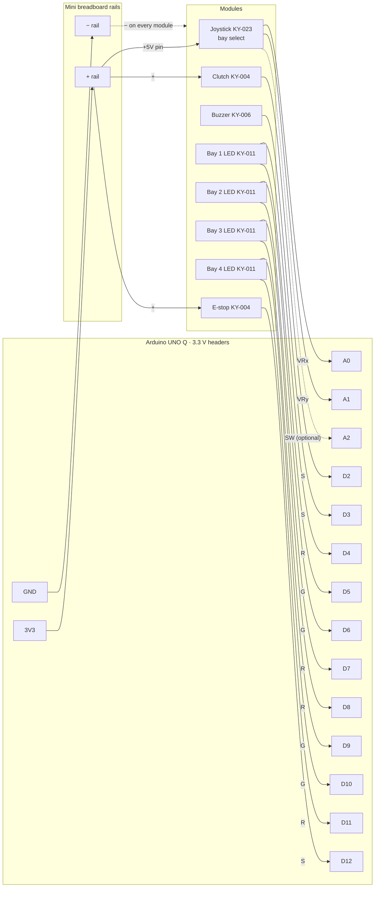

# Operator console hardware

The physical console for the ATC demo: an Arduino UNO Q on a single printed plate with a bay-select
joystick, a dead-man's clutch, an E-stop, four bay status LEDs and an alert buzzer. Everything is
wired with jumper cables. There is no soldering and no custom PCB. A mini breadboard provides the
shared 3V3 and GND rails.

- Schematic page (open in a browser): [`wiring.html`](wiring.html)
- Firmware and bridge that read this hardware: `T-131` (`firmware/unoq_console/`, `src/teleop/unoq/mcu_bridge.py`)

## Sensor suite

All modules come from the joy-it SensorKit X40 (`SEN-Kit02`). joy-it lists the modules by name
only. The KY numbers below are the standard ones for this kit, so check the label printed on
each board.

| Qty | Kit module | ID | Role |
|---|---|---|---|
| 1 | Joystick module (XY-axis) | KY-023 | Bay select: push up 1, right 2, down 3, left 4 (recalibratable) |
| 2 | Button module | KY-004 | Hold-to-control clutch, per-robot E-stop |
| 4 | 5mm 2-colour LED (red + green) | KY-011 | Bay status: green nominal, red stalled or queued, both = amber |
| 1 | Passive piezo-buzzer module | KY-006 | Stall and queue alert tones |
| - | UNO Q built-in 8×13 LED matrix | - | 4-bay status dashboard (no wiring) |

Other parts:

- Mini breadboard, 170 tie-point (about 46 × 35 mm). The plate has a locating rim for it.
- About 25 jumper wires: female-to-male from modules to the breadboard, and male-to-male from the breadboard to the UNO Q.
- 8 × 150-220 Ω resistors, one per LED colour, **only if** the KY-011 boards have no on-board resistor (see wiring rules).

## Pin map

All MCU header pins are 3.3 V logic (STM32U585).

| UNO Q pin | Module | Module pin | Firmware meaning |
|---|---|---|---|
| A0 | Joystick KY-023 | VRx | left / right → `BTN:BAY:4` / `BTN:BAY:2` (default map) |
| A1 | Joystick KY-023 | VRy | up / down → `BTN:BAY:1` / `BTN:BAY:3` (default map) |
| A2 | Joystick KY-023 | SW | optional: click re-sends the bay, hold 2 s to calibrate |
| D2 | Clutch KY-004 | S | `CLUTCH:0\|1` |
| D12 | E-stop KY-004 | S | `ESTOP:0\|1`, each press toggles `POWER:<bay>:0\|1` |
| D3 (PWM) | Buzzer KY-006 | S | `tone()` alerts |
| D5 (PWM) / D4 | Bay 1 LED KY-011 | G / R | `CMD:BAY_STATE:1:…` |
| D6 (PWM) / D7 | Bay 2 LED KY-011 | G / R | `CMD:BAY_STATE:2:…` |
| D9 (PWM) / D8 | Bay 3 LED KY-011 | G / R | `CMD:BAY_STATE:3:…` |
| D10 (PWM) / D11 | Bay 4 LED KY-011 | G / R | `CMD:BAY_STATE:4:…` |
| 3V3 | Breadboard + rail | joystick `+5V` pin, both button `+` pins | |
| GND | Breadboard − rail | every module `−` / `GND` pin | |

Green channels are on PWM pins so the firmware can do the breathing pulse for `NOMINAL`.
Free for later, for example the judge fault rig: D0/D1 (UART), D13, A3-A5.

## Wiring diagram

## Wiring rules

1. **LED resistors.** KY-011 boards often have no series resistor. Look for tiny parts marked
   151, 221 or 331 on the LED board. If there are none, put a 150-220 Ω resistor in series
   with each R and G line on the breadboard. Never drive a bare LED straight from a GPIO.
2. **Power the joystick and buttons from 3V3, never 5V.** The joystick pin is labelled `+5V`,
   but it goes to the 3V3 rail. A0 and A1 are not 5 V tolerant, and 3.3 V also matches the
   ADC's full range.
3. **Wire all three button pins** (S, +, −). Boards differ on whether pressing pulls S high or
   low, so the firmware reads the idle level at boot and treats the opposite level as pressed.
4. **Match the silkscreen**, not the pin position. Pin order differs between module batches.
5. **One ground.** Every module's − pin goes to the breadboard GND rail, and the rail goes to
   a UNO Q GND pin. The buzzer's middle pin is unused.

## Operating the console (`T-216`)

Each bay LED is one robot in the web fleet console (`teleop atc`): LED 1 is Bay 1, and so on.

- **Select a robot:** flick the joystick. The bay's matrix tile gets a bright underline and the
  web console highlights that bay.
- **Drive it:** hold the clutch. The gloves only move the selected robot while the clutch is held,
  and only if that robot has power. Letting go stops it.
- **E-stop:** a press cuts power to the selected robot. Its brakes hold the arm where it is, its
  belt stops, the gloves are ignored, its LED is solid red, its matrix tile shows a hollow box
  and its web tile shows *E-STOP · Power cut*. Press the E-stop again with the same bay selected
  to restore power, and the robot carries on from where it stopped. With no bay selected, a press
  cuts every robot, or restores all of them when all are cut. A low tick every 4 s means some
  robot is still powered off. The MCU forgets the cuts when it reboots, so the host sends them
  back when it sees `BOOT`. `E` on the keyboard does the same from the web console.
- **Buttons:** the level each button reads at boot counts as released, so either KY-004 polarity
  works. Don't hold the clutch or the E-stop while the board boots.

Bay LED colours: green nominal, red blink stalled, amber queued, red/amber alternating while an
operator rescues it, amber blink validating, slow green blink autonomous skill, red/green
alternating refused (OOD), solid red power cut.

### Calibrating the joystick

The stick's directions depend on how the board sits in the plate. Calibrate once after assembly:

    uv run teleop unoq --host <board-ip> --calibrate-joystick

You can also hold the stick pressed for 2 s if A2 is wired. All four LEDs go amber: let go of the
stick so its centre is captured. Then each bay's LED blinks amber in turn, Bay 1 to 4: push the
stick towards where you want that bay. A direction that's already taken buzzes low, so push
another one. When all four are set, the map is saved on the board
(`~/.config/teleop/unoq_joystick_map`) and restored on every start and MCU reboot.

`--joy-map 2431` sets the map directly (the bays for raw stick X+, X-, Y+, Y-; `2431` is the
default). `--joy-raw` prints the raw ADC values for 15 s to check the wiring.

## Differences from the `T-131` acceptance list

`T-131` was written for four separate bay buttons with `INPUT_PULLUP`. The console as built
differs:

- **Bay select is a joystick on A0/A1.** The firmware reads the centre position at boot and emits
  `BTN:BAY:n` once each time the stick passes about 60 % of its travel. The direction-to-bay map
  is calibrated on the console (see above), not hard-coded. The serial protocol (`BTN:BAY:1..4`)
  is unchanged.
- **Buttons are not assumed active-low.** See wiring rule 3.
- **The E-stop latches per robot** instead of acting as a global level (see above).
- **The bay LEDs mirror the matrix.** `CMD:BAY_STATE` drives both the 8×13 matrix tile and the
  bay's KY-011 (colours above).
- **No fault rig pin is assigned yet.** Use D13 or A3 when the rig is built.

## Enclosure

A single-plate prototype (203 × 158 mm, printed face-up without supports in roughly 2.5-3.5 h on
a Bambu P2S). Each module slides into rails on the plate. The UNO Q sits on four standoffs with
its LED matrix facing up and USB-C at the left edge. The clutch and E-stop caps twist-lock into
collars so they can't be pulled off. Module board sizes in the CAD are estimates until measured.

### Print files

All three fit on one P2S plate. PLA, 0.2 mm layers, no supports.

| File | Qty | Orientation on the bed |
|---|---|---|
| [`cad/console_plate.stl`](cad/console_plate.stl) | 1 | As exported (flat base down) |
| [`cad/console_cap_clutch.stl`](cad/console_cap_clutch.stl) | 1 | Flip so the flat top is on the bed |
| [`cad/console_cap_estop.stl`](cad/console_cap_estop.stl) | 1 | Flip so the flat top is on the bed |

The STLs are in millimetres and exported in their assembled position, so use Bambu Studio's
**Lay on Face** (F) on the caps' top face.

### Assembly

1. Slide each module into its rails from the back, header pins facing away from the operator.
   The joystick drops into its pocket from above.
2. Seat the UNO Q on the four pegs, USB-C toward the left edge.
3. Push each cap into its collar with the two tabs lined up with the notches, then turn it 90°
   until it stops. To remove a cap, turn it back to the notches and lift.

Estimated module sizes used in the CAD (measure yours before printing if you can): small KY
boards 15 × 18.5 mm, joystick board 34 × 26 mm, KY-004 switch height 5 mm (the caps allow up to
2.5 mm taller).
