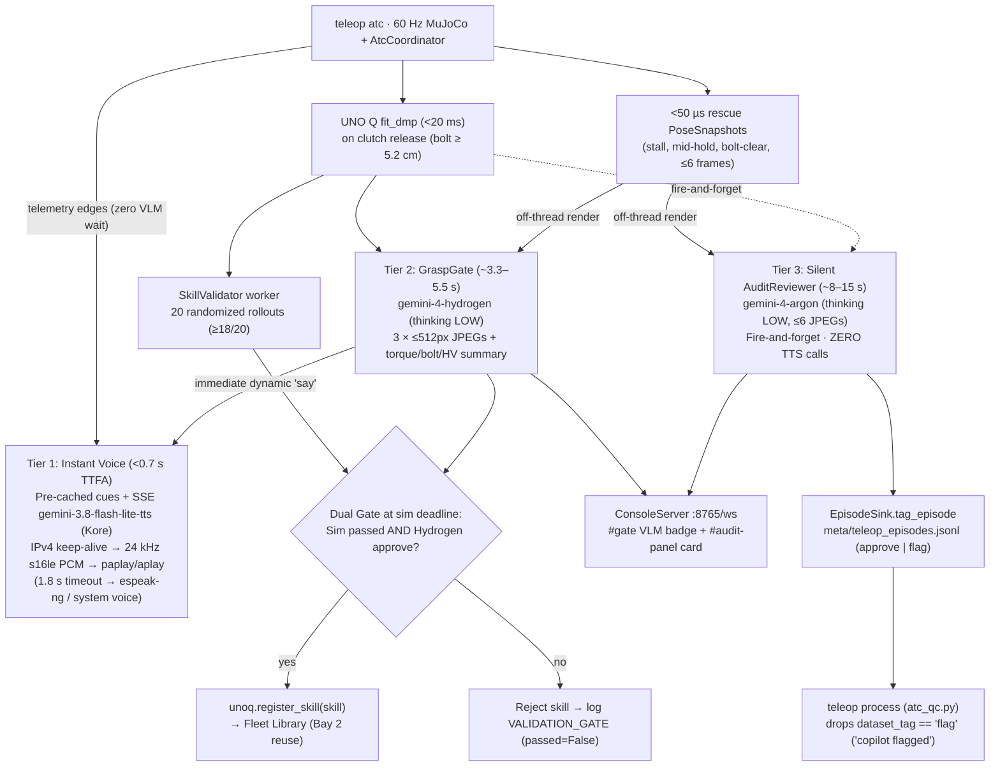

# Operator Copilot & Active Grasp Gate (Three-Tier Gemini) Implementation Plan

> **For agentic workers (Antigravity or any coding agent):** read `CLAUDE.md` and
> `CONTRIBUTING.md` first and follow their workflow: inspect `git status`, `git worktree list`,
> and `git ls-remote origin 'refs/claims/*'`, use dedicated git worktrees on a
> `<type>/<kebab-summary>` branch without touching claimed/locked files, verify with `ruff`,
> `pyright`, and `pytest`, and commit with Conventional Commits (zero `Co-Authored-By` trailers).
> Steps use checkboxes (`- [ ]`).

**Goal:** A three-tier, low-latency Gemini operator copilot and active physical grasp gate for the
4-bay EV battery disassembly fleet (`teleop atc` in-process and `python -m teleop.copilot`
sidecar):

1. **Tier 1 — Instant Voice (`< 0.7 s` warm TTFA, zero VLM wait):** Pre-cached and deterministic
   telemetry call-outs plus SSE-streamed `gemini-3.8-flash-lite-tts` (`Kore` voice) over a
   persistent IPv4 `HTTPSConnection` (`keep-alive`), piping raw 24 kHz 16-bit mono PCM into
   `paplay --raw` / `aplay` (with a cross-platform WAV fallback) and falling back automatically to
   `espeak-ng` / system voice if chunk 1 exceeds `1.8 s` (`1.5–2.0 s`).
2. **Tier 2 — Inline Fast Grasp Gate (`~3.3–5.5 s`, `gemini-4-hydrogen`):** Runs in parallel with
   `SkillValidator`'s 20 randomized MuJoCo rollouts on `AtcCoordinator`'s background gate upon
   clutch release (`bolt >= 5.2 cm`), evaluating 3 `<= 512 px` rescue keyframes (`stall`,
   `mid-hold`, `bolt-clear`) + contact torque / bolt / HV clearance / flap depression telemetry
   (`thinkingLevel="LOW"`, `mediaResolution="MEDIA_RESOLUTION_LOW"`). Both Sim (`>= 18/20`) and
   Hydrogen (`verdict == "approve"`) must approve before `unoq.register_skill(skill)` promotes the
   DMP to the Fleet Library, while Hydrogen's dynamic `"say"` verdict streams immediately via Tier 1
   SSE TTS.
3. **Tier 3 — Silent Deep Audit (`~8–15 s`, `gemini-4-argon`):** Runs fire-and-forget on a
   background worker (`thinkingLevel="LOW"`, up to 6 `<= 512 px` frames + bay timeline) with **zero
   TTS calls** and **zero gate blocking**, populating the Fleet Ops Console `#audit-panel`
   second-opinion card and asynchronously tagging LeRobot episode metadata (`dataset_tag`:
   `"approve" | "flag"`) in `meta/teleop_episodes.jsonl` for `teleop process` (`atc_qc.py`) ACT
   dataset curation.

Offline, `--headless`, and `--no-gemini` runs remain 100% deterministic, falling back to local
`Gemma` (`COPILOT_LOCAL_URL` / `gemma4:e4b`) if configured or physics-only otherwise.

**Non-goals.**

- **No low-level robot teleop or key injection:** The copilot never drives joints/actuators, never
  sends operator `"key"` presses (`on_key`), never blocks the 60 Hz MuJoCo control loop, never
  alters stall detection or torque safety tubes/aborts, and never reads simulator ground truth
  (`true_world_latch()`, `flap_hinge`, `data.contact`) for control or gating.
- **No edge deployment:** It runs on the host workstation, not on the Arduino UNO Q.
- **No full downstream ACT policy training in this plan:** Active grasp gating
  (`AtcCoordinator._Gate`) and episode metadata tagging/QC filtering (`T-191` / `T-193`) **are** in
  scope, whereas remote/CUDA ACT policy training and Verda release runs (`T-194`, `T-195`, `T-198`)
  remain separate and out of scope for this showcase.

**Tech stack:** Python 3.12, uv, stdlib `http.client` + `socket` + `ssl` (persistent IPv4
`HTTPSConnection` for SSE TTS) and `urllib` / `json` / `base64` / `wave`, MuJoCo off-thread keyframe
rendering (`Pillow` `<= 512 px` JPEG), `websockets` (already installed), Gemini REST & SSE
endpoints, and `paplay --raw` / `aplay` / WAV / `espeak-ng` audio playback.

## How it fits the system

Bays run their routine unlatching push until one jams. A human rescues the bay with the gloves and
clutch, and the UNO Q fits the rescue as an RBF-DMP skill (`< 20 ms`). On clutch release with
`bolt >= 5.2 cm` (`0.052 m`), `AtcCoordinator` runs a parallel **Dual Validation Gate** off the
60 Hz loop against a `10.0 s` sim-time deadline: `SkillValidator` (20 randomized headless simulation
rollouts, `>= 18/20` required, `T-179`) alongside Tier 2 `GraspGate` (`gemini-4-hydrogen`). Both
must approve before `unoq.register_skill(skill)` deploys the skill to the Fleet Library for Bay 2
reuse, while rescues are simultaneously logged and curated as LeRobot episodes (`T-191` / `T-193`).

The copilot supports two execution topologies:

1. **Integrated In-Process Runtime (`uv run teleop atc`):** Default showcase path when
   `GEMINI_API_KEY` (or `COPILOT_LOCAL_URL`) is present and neither `--headless` nor `--no-gemini`
   is passed. Hooks directly into `AtcCoordinator` (`grasp_gate`, `audit_sink`),
   `EpisodeSink.tag_episode`, and `ConsoleServer` telemetry (`gate` VLM status + `audit` report),
   while suppressing duplicate legacy `stage.py` `AudioCues`.
2. **Standalone Sidecar (`uv run python -m teleop.copilot {run,watch,probe}`):** Connects to
   `ws://127.0.0.1:8765/ws` as a console client for live telemetry/frame monitoring, spoken
   call-outs, background Argon audits, and `"copilot_audit"` WebSocket ingress.



## Global Constraints

- Python 3.12. uv only. Quaternions xyzw. Clocks: `time.monotonic_ns()`. Strict `pyright` across
  `src/teleop/`.
- **No new third-party dependencies (`T-194` lock).** `pyproject.toml`, `uv.lock`,
  `scripts/train_act.py`, and `docs/training/verda.md` are owned by `T-194` (actively claimed on
  `origin/refs/claims/T-194`) — **do not edit or claim them**. Use stdlib `http.client`, `socket`,
  `ssl`, `urllib`, `json`, `base64`, `wave`, `subprocess`, and `threading`, plus existing
  `websockets`, `numpy`, `mujoco`, `pillow`, and `python-dotenv`.
- **Forbidden / locked shared files (DO NOT EDIT):**
  - `T-100` / shared locks: `src/teleop/cli.py`, `scripts/fetch_models.py`,
    `configs/hands/leap.yaml`, `.env.example`, `.pre-commit-config.yaml`,
    `src/teleop/compliance/solana.py` (and `src/teleop/compliance/protocol.py`,
    `src/teleop/atc/types.py`, `src/teleop/reasoning/nemotron.py`).
  - `T-195` (actively claimed): `src/teleop/policy/act_runtime.py`,
    `src/teleop/atc/act_recovery.py`.
  - **Golden determinism guard:** `tests/atc/golden/dmp_stage.json` (`2386` ticks and exact
    9-decimal wrist coordinates on Linux) **must not drift**.
  - **Console self-containment rule:** Zero `http://` or `https://` substrings anywhere (even in
    comments!) inside `src/teleop/console/web/*` (`tests/console/test_web_assets.py`).
  - Standalone CLI remains `uv run python -m teleop.copilot {probe,watch,run}`; `src/teleop/commands/atc.py`
    (`uv run teleop atc`, unlocked) adds `--no-gemini` and wires the in-process 3-tier runtime
    without touching `src/teleop/cli.py`. Document env vars in `docs/copilot.md` instead of
    `.env.example`.
- **Active grasp gating & retained control boundaries:**
  - `AtcCoordinator` (`src/teleop/atc/coordinator.py`) invokes `GraspGate` (`teleop.copilot.gate`)
    in parallel with `SkillValidator` before `unoq.register_skill(skill)`, and `AuditReviewer`
    (`teleop.copilot.review`) tags episodes via `EpisodeSink.tag_episode` and publishes audit state
    to `ConsoleServer`.
  - **Retained hard prohibitions:** No code path in `teleop.copilot` may ever send operator `"key"`
    control messages (`{"type": "key", ...}` or `.on_key(...)`), drive robot actuators directly,
    block the 60 Hz physics loop, or read simulator ground truth (`true_world_latch()`,
    `flap_hinge`, `data.contact`). Update
    `tests/copilot/test_gemini.py::test_copilot_never_imports_the_coordinator_or_sends_keys` to
    enforce the `"key"` / `.on_key` prohibition while permitting grasp-gate types and
    `"copilot_audit"` WebSocket publishing.
- **100% offline determinism:** Offline `pytest`, CI, `--headless`, `--no-gemini`, and unset
  `GEMINI_API_KEY` (when `COPILOT_LOCAL_URL` is unset) make **zero external network calls** and
  execute the deterministic physics-only path (`2386` golden ticks in `tests/atc/test_recovery.py`).
  Live API latency and verdict checks use `.env` `GEMINI_API_KEY` in `@pytest.mark.hardware` /
  env-gated tests and `probe`.
- **Secrets:** read keys only from the environment or `.env` (gitignored). Never log or print a
  key, and never commit one.
- **Privacy:** camera frames are sent to Google when images are enabled. `--no-images` strips every
  image part across Tier 2 `GraspGate`, Tier 3 `AuditReviewer`, and live call-outs.
- Verify before every commit/PR:
  `uv run ruff check . && uv run ruff format --check . && uv run pyright && uv run pytest`
- **Conventional Commits.** Allowed scopes: `input, sim, retarget, record, train, cli, infra,
  docs, tasks, net, atc, unoq` (**never** `console` or `copilot` — use `atc` for copilot/console/gate,
  `record` for `episodes.py`/`atc_qc.py`, `docs`/`tasks` for docs and task files). Zero
  `Co-Authored-By` or "Generated with" lines.
- **Task IDs & worktree isolation.** Concurrent agents hold claims on `T-191`, `T-194`, `T-195`,
  `T-208`, `T-212`, `T-218`, `T-219`, `T-222`, `T-230`, `T-231`, `T-232`. Keep copilot specs scoped
  to `T-210`–`T-215` inside dedicated worktree `/home/ethan/Documents/UCL_repos/copilot-grasp-gate`
  (`feat/copilot-grasp-gate`) without mutating `/home/ethan/Documents/UCL_repos/Junction` or
  pushing `refs/claims/*`.

## Models and configuration

| Tier / Role | Default model ID | Env var | Endpoint & Configuration | Latency / Fallback |
|---|---|---|---|---|
| **Tier 1: Instant Voice & SSE TTS** | `gemini-3.8-flash-lite-tts` | `COPILOT_TTS_MODEL` | `POST /v1beta/models/{model}:streamGenerateContent?alt=sse` over persistent IPv4 `HTTPSConnection` (`keep-alive`, `TCP_NODELAY`, `SO_KEEPALIVE`), `responseModalities: ["AUDIO"]`, **no `thinkingConfig`**, 24 kHz s16le mono PCM | Target `< 0.7 s` warm TTFA (`483–653 ms` live; `< 1.5 s` cold); startup `precache_cues` (`< 50 ms`); `first_chunk_timeout_s = 1.8` (`1.5–2.0 s`) -> `espeak-ng -s 230` / system voice |
| **TTS Voice** | `Kore` | `COPILOT_VOICE` | Prebuilt Gemini TTS voice (`Charon` optional alternative) | Firm, clear booth voice |
| **Tier 2: Inline Fast Grasp Gate & Live Call-outs** | `gemini-4-hydrogen` | `COPILOT_FAST_MODEL`, `COPILOT_FAST_THINKING=low` | `POST /v1beta/models/{model}:generateContent`, `thinkingConfig: {"thinkingLevel": "LOW"}`, `mediaResolution: "MEDIA_RESOLUTION_LOW"`, structured JSON (`responseJsonSchema` or `responseSchema` without `additionalProperties`) | `~3.3–5.5 s` on 3 `<= 512 px` JPEGs + telemetry; dynamic `verdict.say` piped immediately to Tier 1 SSE TTS; fallback: `COPILOT_LOCAL_URL` (`gemma4:e4b`) else physics-only |
| **Tier 3: Silent Deep Audit** | `gemini-4-argon` | `COPILOT_REVIEW_MODEL`, `COPILOT_REVIEW_THINKING=low`, `COPILOT_MAX_REVIEWS_PER_HOUR=20` | `POST /v1beta/models/{model}:generateContent`, `thinkingConfig: {"thinkingLevel": "LOW"}`, up to 6 `<= 512 px` JPEGs + bay rescue timeline, fire-and-forget daemon worker | `~8–15 s` typical (90 s socket cap); **strictly silent (0 TTS calls)**; populates `#audit-panel` + `meta/teleop_episodes.jsonl` (`approve` \| `flag`) |
| **Local VLM Fallback (`T-214`)** | `gemma4:e4b` | `COPILOT_LOCAL_URL`, `COPILOT_LOCAL_MODEL` | `POST {local_url}/chat/completions` (OpenAI-compatible multimodal JSON) | Used when `GEMINI_API_KEY` is unset or `--no-gemini` is passed while `COPILOT_LOCAL_URL` is set; otherwise 100% deterministic physics-only |
| **Console & CLI Flags** | `ws://127.0.0.1:8765/ws` | `COPILOT_CONSOLE_URL`, `GEMINI_API_KEY` | `--no-gemini` on `teleop atc`; `--no-images`, `--mute`, `--env-file` on `teleop.copilot` | `.env` discovered in process env -> worktree -> main checkout root |

## Console stream & telemetry contract

- **Endpoint:** `ws://127.0.0.1:<port>/ws`, default port 8765 (`--console-port` on `teleop atc`).
  Several clients may connect, and a new client gets the latest telemetry and frames straight away.
- **Text messages** are telemetry JSON (`type: "telemetry"`, about 10 Hz), built in
  `src/teleop/console/telemetry.py`. Fields:
  - `sim_t`, `wall`, `mode` (`"grid"` or `"rescue"`), `layout_id`
  - `feeds`: `[{slot, camera, bay, role}]`, where role is `tile`, `main` or `strip`
  - `bays`: `[{id, state, confidence, history, queue_position, skill, x_bolt_cm, fault, replayed}]`.
    `state` is one of `NOMINAL, STALLED, QUEUED, RESCUE, VALIDATING, AUTONOMOUS_SKILL,
    OOD_ESCALATED, STANDBY`. While a bay is parked after a stall, its confidence is the value
    held at the stall.
  - `queue`, `selected_bay`, `rescue` (`{bay, clutch, elapsed_s}` or null), `bolt_clear_cm` (5.2),
    `threshold` (0.3)
  - `gate`: `{fit_ms, passed, total, elapsed_s, ok, conditions?, worst_failure?, vlm_verdict?, vlm_reason?, vlm_model?, vlm_latency_ms?, vlm_source?}` or null (backward-compatible extension showing Sim `18/20` + Hydrogen VLM gate status)
  - `audit`: `AuditReport.to_dict()` (`{audit_id, status: "pending"|"complete"|"skipped"|"error", bay, skill_id, episode_uid, verdict: "approve"|"flag"|null, dataset_tag: "approve"|"flag"|null, confidence, reasons, operator_note, model, frame_count, latency_ms, wall}`) or null
  - `events` (the Activity log), `actions` (operator key outcomes `{seq, key, text, level}`),
    `compliance`, `reasoning`, `beat`
- **Binary messages** are camera frames. Byte 0 is the feed slot, byte 1 is `layout_id % 256`,
  and the rest is one JPEG. Map slot to camera with the latest `feeds`, and drop frames whose
  byte 1 does not match the current `layout_id % 256`.
- **Rescue mode:** feeds include `bayN/top_ortho`, `bayN/side_ortho`, and `bayN/wrist_cam`
  close-ups of the bay being rescued. Grid mode shows each bay's `bayN/cctv`. Bays 3–4 replay a
  recorded cycle (`replayed: true`) and never stall.
- **No `"key"` messages from copilot.** Standalone `python -m teleop.copilot run` only sends
  `{"type": "copilot_audit", "audit": ...}` so `ConsoleServer` can update `#audit-panel`.

## Behaviour

### Tier 1 — Instant Voice (`< 0.7 s` Target, Zero VLM Wait) & SSE-Streamed Gemini TTS (`tts_stream.py`, `speech.py`)

- **Persistent IPv4 transport (`IPv4HTTPSConnection`):** Resolves `socket.AF_INET` via
  `socket.getaddrinfo`, sets `TCP_NODELAY=1` and `SO_KEEPALIVE=1`, wraps TLS with SNI
  `server_hostname="generativelanguage.googleapis.com"`, reuses `Connection: keep-alive` sockets
  across utterances, auto-reconnects once on stale keep-alive sockets, and closes the socket
  cleanly on timeout/abort.
- **SSE streaming (`GeminiStreamingTTS.stream_pcm`):** Calls
  `POST /v1beta/models/gemini-3.8-flash-lite-tts:streamGenerateContent?alt=sse` (`voice="Kore"`,
  `responseModalities=["AUDIO"]`, **no `thinkingConfig`**). Parses SSE `data: {...}` frames,
  base64-decoding `inlineData.data` (`audio/l16; rate=24000; channels=1` -> raw 24 kHz 16-bit
  signed LE mono PCM chunks) until `finishReason == "STOP"` and stream EOF (`b""`).
- **Direct raw PCM playback & fallbacks:** Pipes PCM chunks directly into
  `paplay --raw --format=s16le --rate=24000 --channels=1 --latency-msec=40` (primary) or
  `aplay -q -f S16_LE -r 24000 -c 1 -t raw -` (secondary), with cross-platform `pcm_to_wav` ->
  `paplay` / `aplay` / `afplay` / PowerShell `SoundPlayer` WAV fallback when raw players are
  absent. (Set `proc.stdin = None` after `proc.stdin.close()` before `proc.wait()` for Python 3.12
  `subprocess` safety.)
- **First-chunk timeout (`1.8 s`, within `1.5–2.0 s`):** If chunk 1 exceeds
  `first_chunk_timeout_s` or errors, aborts the stream/socket and immediately speaks via
  `espeak-ng -s 230` (tried before `espeak` / `spd-say -w -r 30` / macOS `say` / `WindowsVoice`),
  guaranteeing late audio is never played out of order.
- **Startup pre-caching (`precache_cues`) & zero-VLM telemetry alerts:** At startup (when
  `GEMINI_API_KEY` is set and not `--mute`), warms the TLS socket and pre-caches fixed short
  telemetry cues (`stall`, `ood`, `clutch_engage`, `bolt_cleared`, `clutch_release_short`,
  `validating`, `gate_passed`, `gate_failed`, `autonomous`) in memory/disk (`< 50 ms` playback,
  zero VLM wait). Queue rules: max 2 waiting items, `alarm` priority jump, 10 s stale drop,
  `--mute` silence.

### Tier 2 — Inline Fast Grasp Gate (`~3.3–5.5 s`, Gemini 4 Hydrogen) (`gate.py`, `atc/coordinator.py`)

- **Trigger & parallelism:** When the operator releases the clutch with `bolt_x >= 0.052 m`
  (`5.2 cm`), `AtcCoordinator._submit_gate` fits the DMP (`unoq.fit_dmp(...)`) and submits **both**
  `SkillValidator.validate(skill)` (20 randomized rollouts, pass `>= 18/20`, on `self._executor`)
  **and** `GraspGate.submit(...)` (on `GraspGate`'s own dedicated background worker with a private
  `MjModel` / `MjData` / `mj.Renderer` copy).
- **Inputs:** During clutch hold, `AtcCoordinator` captures lightweight `< 50 µs` `PoseSnapshot`s
  (`qpos`, `mocap_pos`, `mocap_quat`, `body_pos`, `body_quat`) at 3 semantic milestones —
  **`stall`** (rescue start), **`mid-hold`** (peak contact / flap depression), and **`bolt-clear`**
  (`bolt_x >= 5.2 cm` / release) — rendered off-thread into 3 `<= 512 px` JPEGs (`KeyframeJpeg`,
  omitted if `--no-images`), paired with `GraspTelemetrySummary` (`bay_id`, `sku`, `skill_id`,
  `signature_id`, `duration_s`, `bolt_start_m`, `bolt_final_m`, `peak_tau_hand_nm`,
  `mean_tau_hand_nm`, `peak_arm_ratio`, `min_wrist_x_latch_m` for `-X` HV battery terminal
  clearance, `min_wrist_z_latch_m` for flap depression geometry, `touch_offset_m`).
- **Model call & structured output (`GraspGateVerdict`):** `gemini-4-hydrogen` with
  `thinkingLevel="LOW"` and `mediaResolution="MEDIA_RESOLUTION_LOW"`, returning JSON:
  `{"verdict": "approve"|"reject", "say": str (<= 15 words), "reason": str, "flap_depressed": bool, "bolt_clearance_ok": bool, "hv_clearance_ok": bool, "torque_controlled": bool, "confidence": 0..1}`.
- **Immediate dynamic voice:** As soon as Hydrogen resolves (`~3.3–5.5 s`, without waiting for the
  20-rollout `SkillValidator` or the `10.0 s` sim-time gate deadline), `GraspGate` dispatches
  `verdict.say` straight to Tier 1 SSE `gemini-3.8-flash-lite-tts` (`Kore`).
- **Dual-approval enforcement:** In `_apply_gate` at `time_s >= gate.deadline`,
  `approved = sim_report.passed and (grasp_verdict is None or grasp_verdict.approved)`.
  `unoq.register_skill(skill)` and `"SKILL_DEPLOYED"` execute **if and only if** both Sim and
  Hydrogen approve; if either rejects, the skill is withheld (`"VALIDATION_GATE"` records
  `passed=False` plus VLM gate metadata).
- **Standalone call-outs (`CalloutService`):** In standalone `python -m teleop.copilot run` mode,
  `CalloutService` continues to use `gemini-4-hydrogen` (`thinkingLevel="LOW"`) with the 1 s
  deterministic template fallback for live telemetry events (`stall`, `refused`, `gate_result`,
  `autonomous_finished`).

### Tier 3 — Silent Deep Audit (`~8–15 s`, Gemini 4 Argon — UI + Dataset Only) (`review.py`, `console/*`, `episodes.py`, `atc_qc.py`)

- **Fire-and-forget & strictly silent:** Triggered asynchronously on a daemon worker
  (`AuditReviewer.submit`, bounded by `COPILOT_MAX_REVIEWS_PER_HOUR`, default 20) with up to 6
  `<= 512 px` JPEG rescue frames (`2 stall / early`, `2 mid-hold`, `2 clear / release`) + full bay
  rescue timeline (`thinkingLevel="LOW"`). **NEVER calls `Speaker` / TTS (0 TTS calls)** and
  **NEVER blocks `AtcCoordinator._Gate`, `unoq.register_skill`, or Bay 2**.
- **Structured output (`AuditReport`):** `verdict: "approve" | "flag"`,
  `dataset_tag: "approve" | "flag"`, `confidence: 0..1`, `reasons: list[str]`,
  `operator_note: str (<= 60 words)` (unverified / `insufficient_evidence` cases map safely to
  `dataset_tag="flag"` or explicit flagged handling per schema).
- **Console UI (`#audit-panel`):** Immediately emits `status="pending"` on submit and
  `status="complete"` (or `"skipped"` / `"error"`) on completion to `ConsoleServer`, rendering a
  dedicated engineering audit / second-opinion card in the Fleet Ops Console rail.
- **ACT dataset curation (`T-191` / `T-193`):** `EpisodeSink` assigns a monotonic `episode_uid` per
  recorded episode (`latest_episode_uid(bay_id)`) and exposes thread-safe
  `EpisodeSink.tag_episode(episode_uid, *, dataset_tag="approve"|"flag", audit=report.to_dict())` —
  handling both the pre-encode queue (if Argon finishes before LeRobot AV1 video encoding) and
  atomic locked rewrite of `<root>/meta/teleop_episodes.jsonl` (if Argon finishes after
  `end_episode`). `src/teleop/process/atc_qc.py` adds `"copilot flagged"` to `DROP_REASONS` and
  drops episodes where `meta.get("dataset_tag") == "flag"` while keeping `"approve"` and untagged
  (`None`) offline episodes.

### Deterministic Offline & Local Gemma Fallback

When `--no-gemini` is passed or `GEMINI_API_KEY` is unset:

1. If `COPILOT_LOCAL_URL` is configured (and not `--headless`): `LocalModelClient`
   (`COPILOT_LOCAL_MODEL`, default `gemma4:e4b`) serves structured JSON for Tier 2 `GraspGate` and
   call-outs; speech uses `espeak-ng` / system voice; Tier 3 reports `status="skipped"`.
2. Otherwise (including all `--headless` runs, `pytest`, and CI): 100% deterministic physics-only
   (`grasp_gate=None` / `source="physics_only"`, zero network calls, zero threads perturbing sim
   ticks, preserving the exact `2386`-tick `tests/atc/golden/dmp_stage.json` run).

### Outputs

- Terminal lines: `[12:01:07] BAY 1 ALARM  Bay 1 stalled on a flap jam. Rescue needed.`
- `runs/copilot/<date>.jsonl`: records per event, call-out, speech (`route`, `start_ms`,
  `speak_ms`), gate verdict, and Argon audit. Never contains keys or raw images (only SHA-256 frame
  hashes).

## File Ownership Map

```text
# M1 — Plans, Docs & Task Specs
docs/copilot.md                                                     # M1 (T-210..T-215 + 3-tier spec)
docs/superpowers/plans/2026-11-14-operator-copilot-plan.md          # M1 (this plan)
tasks/T-210-copilot-foundation.md .. T-215-copilot-console-panel.md # M1
README.md   PROJECT_BRIEF.md                                        # M1 (gate & 3-tier overview)

# M2 — Copilot Three-Tier Core Engine
src/teleop/copilot/__init__.py   __main__.py   config.py   run.py   # T-210, T-212
src/teleop/copilot/gemini.py   tts_stream.py                        # T-210, T-212 (Tier 1 IPv4 + SSE PCM)
src/teleop/copilot/feed.py   events.py   frames.py                  # T-211 (done; feed adds audit send in T-215)
src/teleop/copilot/callouts.py   speech.py   prompts.py             # T-212 (Tier 1 pre-cache + raw PCM + fallback)
src/teleop/copilot/gate.py                                          # Tier 2 (Hydrogen inline GraspGate)
src/teleop/copilot/review.py                                        # T-213 (Tier 3 silent Argon AuditReviewer)
src/teleop/copilot/local.py                                         # T-214 (LocalModelClient Gemma fallback)
tests/copilot/*   tests/copilot/fixtures/*                          # M2 unit & fake-transport tests

# M3 — Active ATC Grasp Gate & CLI Runtime Wiring
src/teleop/atc/coordinator.py   src/teleop/atc/hud.py               # Tier 2 parallel _Gate + dual approval
src/teleop/atc/stage.py   src/teleop/commands/atc.py                # --no-gemini + in-process 3-tier wiring
tests/atc/test_coordinator.py   tests/atc/test_grasp_gate.py        # M3 gate & 2386-tick determinism tests
tests/atc/test_stage.py                                             # M3 stage audio/CLI tests

# M4 — Fleet Ops Console Audit Card & ACT Dataset Curation
src/teleop/console/telemetry.py   server.py   run.py                # T-215 (gate VLM fields + audit + WS ingress)
src/teleop/console/web/{index.html,console.css,console.js,audit.js} # T-215 (#audit-panel + #gate badge, no URLs)
src/teleop/atc/episodes.py                                          # Tier 3 async EpisodeSink.tag_episode (T-191 seam)
src/teleop/process/atc_qc.py                                        # Tier 3 'copilot flagged' drop reason (T-193 seam)
tests/console/*   tests/atc/test_episodes.py   tests/process/test_atc_qc.py

# Strictly Forbidden (Owned by Concurrent Tracks — DO NOT TOUCH)
pyproject.toml   uv.lock   scripts/train_act.py   docs/training/verda.md    # T-194 (claimed)
src/teleop/policy/act_runtime.py   src/teleop/atc/act_recovery.py           # T-195 (claimed)
src/teleop/cli.py   scripts/fetch_models.py   configs/hands/leap.yaml       # T-100 (locked)
.env.example   .pre-commit-config.yaml   src/teleop/compliance/solana.py    # T-100 / T-160 (locked)
```

## Tasks

### T-210: Copilot foundation, Gemini client and model probe

**Files:** `src/teleop/copilot/{__init__,__main__,config,gemini,tts_stream}.py`, `docs/copilot.md`,
`tests/copilot/test_gemini.py`.

- [x] **Config.** `CopilotConfig` loads from env and `.env` (`python-dotenv`): model/voice/thinking
  vars, `COPILOT_CONSOLE_URL` (default `ws://127.0.0.1:8765/ws`), and `no_images`, `mute`.
- [x] **Unary client.** `GeminiClient` with injectable `Transport` (`list_models`,
  `generate_json`, `synthesize`), header-only `x-goog-api-key`, key-scrubbed `GeminiError`
  hierarchy, and `python -m teleop.copilot probe`.
- [ ] **Persistent IPv4 SSE TTS transport (`tts_stream.py`).** `IPv4HTTPSConnection`
  (`socket.AF_INET`, `TCP_NODELAY=1`, `SO_KEEPALIVE=1`, TLS SNI, `Connection: keep-alive`,
  stale-socket single retry, clean `close()` on timeout/abort) + `GeminiStreamingTTS.stream_pcm`
  calling `POST /v1beta/models/{tts_model}:streamGenerateContent?alt=sse` (`Kore` voice,
  `responseModalities: ["AUDIO"]`, no `thinkingConfig`) yielding raw 24 kHz s16le mono PCM chunks.
- [ ] **Low-resolution multimodal support.** Support `media_resolution="MEDIA_RESOLUTION_LOW"` in
  `GeminiClient.generate_json` (and omit `additionalProperties` when sending `responseSchema`).
- [ ] **AST safety boundary (`tests/copilot/test_gemini.py`).** Update
  `test_copilot_never_imports_the_coordinator_or_sends_keys` so raw `"key"` / `.on_key` robot
  control injection remains strictly forbidden while permitting active grasp-gate types and
  `"copilot_audit"` WebSocket publishing.

### T-211: Console feed client, frame store and event detector

**Files:** `src/teleop/copilot/{feed,frames,events}.py`, `tests/copilot/test_feed.py`,
`tests/copilot/test_events.py`, `tests/copilot/fixtures/`.

- [x] **`FeedClient`.** Async WebSocket client with reconnect backoff (1 s to 5 s) parsing
  telemetry and binary JPEG frames (gains outbound `send_audit` for `"copilot_audit"` in `T-215`,
  never `"key"` messages).
- [x] **`FrameStore`.** Latest JPEG per `(bay, camera)` plus rescue clutch-hold ring buffer (up to
  12 frames) and `<= 512 px` Pillow downscaling.
- [x] **`EventDetector` & recorded stage fixtures.** Pure telemetry-diff detector verified against
  recorded 20-rollout gate stage fixtures.

### T-212: Live call-outs and speech

**Files:** `src/teleop/copilot/{callouts,speech,prompts,gate,run}.py`, `__main__.py`,
`src/teleop/atc/{coordinator,hud,stage}.py`, `src/teleop/commands/atc.py`,
`tests/copilot/{test_callouts,test_speech,test_gate}.py`,
`tests/atc/{test_coordinator,test_grasp_gate,test_stage}.py`.

- [x] **Call-outs (`CalloutService`).** 1 s deterministic template fallback, 1 in-flight model call
  per bay, 8 s wall-clock cap, terminal + `runs/copilot/*.jsonl` logging.
- [ ] **Tier 1 Instant Voice (`speech.py`, `tts_stream.py`).**
  - `Speaker.precache_cues(cues)`: warms persistent TLS connection and pre-caches fixed short
    telemetry cues (`Kore` voice) in memory/disk (`< 50 ms` playback, zero VLM calls).
  - `Speaker.say(...)`: plays pre-cached cues immediately; otherwise streams 24 kHz s16le PCM
    chunks via `GeminiStreamingTTS.stream_pcm` directly into `raw_pcm_player_command()`
    (`paplay --raw --format=s16le --rate=24000 --channels=1 --latency-msec=40` ->
    `aplay -q -f S16_LE -r 24000 -c 1 -t raw -`), with `pcm_to_wav` -> `play_wav` fallback when raw
    PCM players are unavailable.
  - First-chunk timeout (`first_chunk_timeout_s = 1.8`, within `1.5–2.0 s`): aborts late stream and
    falls back immediately to `espeak-ng -s 230` / system voice (`espeak-ng` preferred before
    `espeak`, `spd-say -w -r 30`). Active by default when `GEMINI_API_KEY` is set.
- [ ] **Tier 2 Inline Fast Grasp Gate (`gate.py`) & ATC Wiring (`atc/coordinator.py`, `commands/atc.py`, `stage.py`, `hud.py`).**
  - `PoseSnapshot`, `KeyframeJpeg`, `GraspTelemetrySummary`, `GraspGateVerdict`, and `GraspGate`
    (dedicated background executor + private MuJoCo `MjModel`/`MjData`/`mj.Renderer` rendering 3
    `<= 512 px` JPEGs `stall`, `mid-hold`, `bolt-clear`; calls `gemini-4-hydrogen` with
    `thinkingLevel="LOW"`, `mediaResolution="MEDIA_RESOLUTION_LOW"`; immediately speaks
    `verdict.say` via Tier 1 `Speaker`).
  - `AtcCoordinator`: optional `grasp_gate` and `audit_sink` hooks (default `None` = physics-only);
    capture `< 50 µs` rescue pose snapshots (`stall`, `mid-hold`, `bolt-clear`, plus up to 6 frames
    for Tier 3); submit `SkillValidator.validate(skill)` and `GraspGate.submit(...)` in parallel in
    `_submit_gate`; enforce `approved = report.passed and (grasp_verdict is None or grasp_verdict.approved)`
    before `unoq.register_skill(skill)` in `_apply_gate`; record Hydrogen metadata on
    `"VALIDATION_GATE"`.
  - `commands/atc.py` & `stage.py`: add `--no-gemini`, wire in-process 3-tier runtime when
    `GEMINI_API_KEY` or `COPILOT_LOCAL_URL` is set (and not `--headless` / `--no-gemini`), suppress
    duplicate legacy `AudioCues`, and preserve `2386`-tick golden determinism.

### T-213: Deep review of rescues and refusals (Gemini 4 Argon)

**Files:** `src/teleop/copilot/review.py`, `src/teleop/copilot/prompts.py`,
`src/teleop/atc/episodes.py`, `src/teleop/process/atc_qc.py`,
`tests/copilot/test_review.py`, `tests/atc/test_episodes.py`, `tests/process/test_atc_qc.py`.

- [ ] **Silent `AuditReviewer` (`review.py`).** Fire-and-forget daemon worker running
  `gemini-4-argon` (`thinkingLevel="LOW"`, 90 s timeout, rate cap `COPILOT_MAX_REVIEWS_PER_HOUR=20`)
  on up to 6 `<= 512 px` rescue JPEGs + bay rescue timeline. **Strictly zero TTS calls** (`Speaker`
  is never invoked) and **never blocks `_Gate` or Bay 2**.
- [ ] **Structured `AuditReport`.** `audit_id`, `status` (`"pending"|"complete"|"skipped"|"error"`),
  `bay`, `skill_id`, `episode_uid`, `verdict` (`"approve"|"flag"|None`), `dataset_tag`
  (`"approve"|"flag"|None`), `confidence`, `reasons`, `operator_note`, `model`, `frame_count`,
  `latency_ms`, `wall`.
- [ ] **Async episode tagging (`episodes.py`) & ACT QC filtering (`atc_qc.py`).** Assign monotonic
  `episode_uid` (`latest_episode_uid(bay_id)`) and implement thread-safe
  `EpisodeSink.tag_episode(episode_uid, *, dataset_tag, audit)` handling both pre-AV1-encode
  pending episodes and post-encode atomic rewrite of `<root>/meta/teleop_episodes.jsonl` under
  `self._lock`. Add `"copilot flagged"` to `DROP_REASONS` in `atc_qc.py`, dropping episodes where
  `meta.get("dataset_tag") == "flag"` while retaining `"approve"` and `None`.
- [ ] **Tests:** 0 TTS calls assertion, fire-and-forget non-blocking execution, hourly rate limit,
  pre-encode and post-encode `tag_episode` race coverage, and `atc_qc.py` `"copilot flagged"`
  filtering.

### T-214: Local Gemma fallback

**Files:** `src/teleop/copilot/local.py`, `tests/copilot/test_local.py`, `docs/copilot.md`.

- [ ] **Client.** `LocalModelClient` (`POST {local_url}/chat/completions`, `COPILOT_LOCAL_URL`,
  `COPILOT_LOCAL_MODEL="gemma4:e4b"`) implementing the same multimodal structured `generate_json`
  contract as `GeminiClient`.
- [ ] **Fallback hierarchy.** Used for Tier 2 `GraspGate` and live call-outs when `GEMINI_API_KEY`
  is unset or `--no-gemini` is passed while `COPILOT_LOCAL_URL` is configured (and not
  `--headless`); when `COPILOT_LOCAL_URL` is unset (or `--headless`), Tier 2 falls back to 100%
  deterministic physics-only (`source="physics_only"`) and call-outs use templates. Tier 3 Argon
  audits skip cleanly (`status="skipped"`, `dataset_tag=None`) when offline.
- [ ] **Tests & docs:** fake HTTP server tests covering multimodal payload, JSON extraction, error
  scrubbing, and fallback transitions; local setup documented in `docs/copilot.md`.

### T-215: Show copilot output in the console (optional, coordinate first)

**Files:** `src/teleop/console/{telemetry,server,run}.py`,
`src/teleop/console/web/{index.html,console.css,console.js,audit.js}`,
`src/teleop/copilot/feed.py` (`"copilot_audit"` send path),
`tests/console/{test_server,test_telemetry,test_web_assets}.py`.

- [ ] **Gate VLM badge (`#gate`).** Render parallel `SkillValidator` rollout score (`18+/20 PASS`)
  alongside the `gemini-4-hydrogen` physical grasp verdict (`approve` / `reject` / `physics-only` +
  reason).
- [ ] **Audit second-opinion card (`#audit-panel`, `web/audit.js`).** Dedicated right-rail card
  displaying Argon `status` (`pending` / `complete` / `skipped` / `error`), `verdict`
  (`approve` / `flag`), `dataset_tag` badge (`ACT: approve` / `ACT: flag`), `confidence`, `reasons`
  list, `operator_note`, `model`, `frame_count`, and `latency_ms`.
- [ ] **WebSocket ingress (`ConsoleServer`).** Accept `{"type": "copilot_audit", "audit": ...}` from
  standalone `teleop.copilot run` and broadcast updated `msg["audit"]`, while never allowing `"key"`
  injection from copilot.
- [ ] **Self-containment.** Zero `http://` or `https://` strings anywhere in
  `src/teleop/console/web/*`.

## Review Focus

1. **No raw key injection or 60 Hz blocking.** `teleop.copilot` never sends `"key"` messages or
   calls `.on_key(...)`, and `GraspGate` / `AuditReviewer` / `EpisodeSink` never touch live
   `co.model` / `co.data` off the control thread or block the 60 Hz physics loop.
2. **Dual-approval gate safety.** `unoq.register_skill(skill)` executes if and only if **both**
   `SkillValidator` (`>= 18/20`) and `GraspGate` (`verdict == "approve"`) pass; a Hydrogen
   `"reject"` blocks Fleet Library promotion even when 20/20 sim rollouts pass, and an
   exception/timeout degrades safely without hanging `VALIDATING`.
3. **Tier 1 low-latency SSE TTS & `1.8 s` fallback.** Persistent IPv4 `HTTPSConnection` streams
   24 kHz s16le PCM into `paplay --raw` / `aplay` (`< 0.7 s` warm TTFA, `< 1.5 s` cold/warm
   verified); if chunk 1 exceeds `1.8 s` (`1.5–2.0 s`), the socket closes and `espeak-ng` / system
   voice speaks immediately with zero out-of-order late audio.
4. **Tier 3 strict silence & async episode tagging race.** `AuditReviewer` (`gemini-4-argon`) makes
   **zero TTS calls**, never delays `_Gate` or Bay 2, updates `#audit-panel`, and
   `EpisodeSink.tag_episode` reliably writes `dataset_tag` (`"approve" | "flag"`) into
   `meta/teleop_episodes.jsonl` whether Argon finishes before or after LeRobot AV1 encoding — and
   `atc_qc.py` drops `"flag"` episodes with `"copilot flagged"`.
5. **100% offline determinism, console self-containment, and key hygiene.** With `GEMINI_API_KEY`
   unset or `--no-gemini` / `--headless`, `pytest` makes zero network calls and
   `tests/atc/test_recovery.py` matches `tests/atc/golden/dmp_stage.json` (`2386` ticks);
   `src/teleop/console/web/*` contains zero `http(s)://` strings; no API key ever appears in logs,
   exceptions, or JSONL; `--no-images` sends zero image bytes.

## Later (not in this plan)

- **Full downstream ACT policy training & Verda GPU release (`T-194`, `T-195`, `T-198`):** Training
  a full ACT neural policy checkpoint on Verda (`scripts/train_act.py`) and live `ActRecovery`
  inference (`act_runtime.py`) belong to the separate `T-190`–`T-198` track and are not required
  for this three-tier copilot & active grasp-gate showcase (which curates and tags the LeRobot
  dataset upstream via `T-191` / `T-193`).
- **Interactive shift Q&A:** Multi-rescue shift summaries and conversational natural-language
  queries ("why did Bay 2 refuse earlier?") over `runs/copilot/*.jsonl`.
