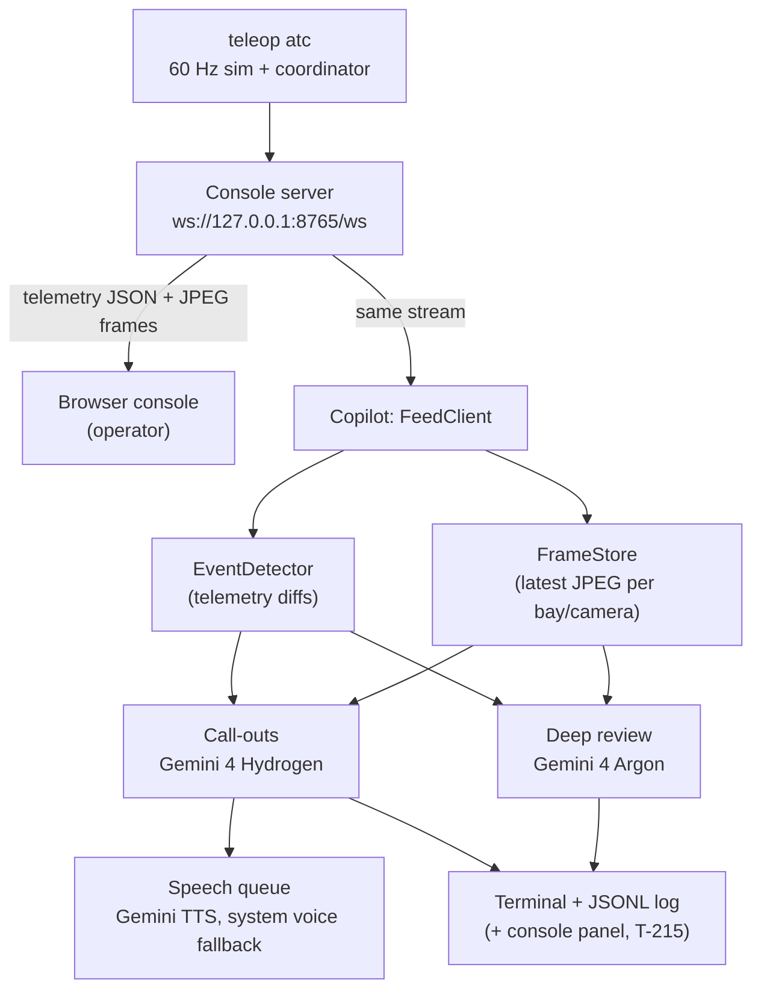

# Operator Copilot (Gemini) Implementation Plan

> **For agentic workers (Antigravity or any coding agent):** read `CLAUDE.md` and
> `CONTRIBUTING.md` first and follow their workflow: `uv run task list --ready`, claim one
> task with `uv run task claim T-NNN --agent <you>`, one git worktree per task on a
> `<type>/<kebab-summary>` branch, verify, open a PR. Steps use checkboxes (`- [ ]`).

**Goal:** A control-room "intermediary" that watches the fleet ops console and helps the human
operator. It explains what is happening in short spoken call-outs, and gives a careful second
opinion before a human rescue is accepted as fleet knowledge. It runs on the operator's
computer and uses Google models: Gemini 4 Hydrogen for fast call-outs, Gemini 4 Argon for deep
reviews, Gemini TTS for speech, and Gemma as an optional local fallback.

**Non-goals.** The copilot never controls a robot. It never sends key presses, and it never
blocks or changes the 60 Hz loop, stall detection, the DMP fit, the 3-rollout gate or any
safety abort. It is advisory only: the human and the existing gates decide. It does not run on
the UNO Q or any edge device.

**Tech stack:** Python 3.12, uv, stdlib `urllib` for HTTPS, the `websockets` package (already a
dependency), the Gemini API REST endpoints, and the system audio player for speech.

## How it fits the system

The loop today: bays run their routine until one jams. A human rescues the bay with the gloves
and clutch, and the rescue becomes a DMP skill on the UNO Q. The skill must pass a
3-rollout simulation gate before it joins the fleet library, and other bays reuse it on matching
jams. Rescues are also logged as training data for the ACT track (`T-190`–`T-198`).

The console (`teleop atc`, default display) already streams everything the copilot needs over
one local WebSocket, so the copilot is a **separate process that connects as a second console
client**. It needs no changes to the simulation, the coordinator or the console server for its
first four tasks.



## Global Constraints

- Python 3.12. uv only. Quaternions xyzw. Clocks: `time.monotonic_ns()`.
- **No new dependencies.** `pyproject.toml` and `uv.lock` are owned by `T-194` (ACT track). Use
  stdlib `urllib`, `json`, `base64` and `wave`, plus the existing `websockets`, `numpy` and
  `pillow` packages.
- **Do not edit:** `src/teleop/cli.py`, `.env.example`, `scripts/fetch_models.py`,
  `.pre-commit-config.yaml` (owned by `T-100`), and `src/teleop/reasoning/nemotron.py` (owned by
  `T-161`). The copilot is started with `uv run python -m teleop.copilot …`, not a `teleop`
  subcommand. Document its environment variables in `docs/copilot.md` instead of `.env.example`.
- Only `T-215` touches console files (`src/teleop/console/server.py`, `web/`). It must coordinate
  with whoever owns open console branches (`feat/console-*`) before starting.
- **Advisory only:** no code path in `teleop.copilot` may call `send` with a `"key"` message or
  import from `teleop.atc.coordinator`.
- **Default `pytest` uses no network, API key, audio device or display.** Gemini and audio go
  through injectable transports, and tests use fakes and recorded telemetry fixtures. Live checks
  are manual commands (`probe`) or tests marked `@pytest.mark.hardware`.
- **Secrets:** read keys only from the environment or `.env` (gitignored). Never log or print a
  key, and never commit one.
- **Privacy:** camera frames are sent to Google. A `--no-images` flag must make every request
  text-only.
- Verify before every PR:
  `uv run ruff check . && uv run ruff format --check . && uv run pyright && uv run pytest`
- **Conventional Commits.** Allowed scopes: `input, sim, retarget, record, train, cli, infra,
  docs, tasks, net, atc, unoq`. Use `atc` for copilot code and `docs` / `tasks` for docs and task
  files. No `Co-Authored-By` or "Generated with" lines.
- **Task IDs.** `T-200`–`T-206` are claimed by another agent, so this plan uses `T-210`–`T-215`.
  Run `git ls-remote origin 'refs/claims/*'` before adding any new IDs.

## Models and configuration

Google's own docs disagree on some model IDs (both Gemini 3.6 and 3.8 Flash are described as the
newest). **`T-210` must confirm every ID with the `probe` command before the defaults below are
relied on.**

| Role | Default model ID | Env var | Notes |
|---|---|---|---|
| Live call-outs | `gemini-4-hydrogen` | `COPILOT_FAST_MODEL` | Fast and multimodal; call with thinking level `low` (its default is `high`; `minimal` is HTTP 400). Target ≤ 3 s per call, hard timeout 8 s. `gemini-3.8-flash` is the fallback. |
| Deep review | `gemini-4-argon` | `COPILOT_REVIEW_MODEL` | Strongest model. Paid tier only, pricier: introductory pricing ends 30 Nov 2026, then doubles. Timeout 90 s. |
| Speech | `gemini-3.8-flash-lite-tts` | `COPILOT_TTS_MODEL` | Alternative: `gemini-3.1-flash-tts-preview`, the only one with streaming. Forums report 10–20 s first-audio delays on some keys, so measure it. |
| Voice | (pick in `T-212`) | `COPILOT_VOICE` | One of the documented prebuilt Gemini TTS voices. |
| Local fallback | Gemma 4 (`E4B` on a CPU laptop, `12B` on a ≥16 GB NVIDIA GPU) | `COPILOT_LOCAL_URL`, `COPILOT_LOCAL_MODEL` | Served by any OpenAI-compatible local server (for example Ollama). Used when Gemini is unreachable. |
| API key | | `GEMINI_API_KEY` | From Google AI Studio. Put it in the repo's `.env`. |

The operator laptop in this repo has an Intel Iris Xe GPU, so it can only run Gemma `E4B`, and
slowly. Treat local Gemma as a backup, not the main path.

## Facts about the console stream (do not change them; read them)

- **Endpoint:** `ws://127.0.0.1:<port>/ws`, default port 8765 (`--console-port` on `teleop atc`).
  Several clients may connect, and a new client gets the latest telemetry and frames straight
  away.
- **Text messages** are telemetry JSON (`type: "telemetry"`, about 10 Hz), built in
  `src/teleop/console/telemetry.py`. Fields used here:
  - `sim_t`, `wall`, `mode` (`"grid"` or `"rescue"`), `layout_id`
  - `feeds`: `[{slot, camera, bay, role}]`, where role is `tile`, `main` or `strip`
  - `bays`: `[{id, state, confidence, history, queue_position, skill, x_bolt_cm, fault, replayed}]`.
    `state` is one of `NOMINAL, STALLED, QUEUED, RESCUE, VALIDATING, AUTONOMOUS_SKILL,
    OOD_ESCALATED, STANDBY`. While a bay is parked after a stall, its confidence is the value
    held at the stall.
  - `queue`, `selected_bay`, `rescue` (`{bay, clutch, elapsed_s}` or null), `gate`
    (`{fit_ms, passed, total, elapsed_s, ok}` or null), `bolt_clear_cm` (5.2), `threshold`
    (0.3)
  - `events` (the Activity log), `actions` (operator key outcomes `{seq, key, text, level}`),
    `compliance`, `reasoning`, `beat`
- **Binary messages** are camera frames. Byte 0 is the feed slot, byte 1 is `layout_id % 256`,
  and the rest is one JPEG. Map slot to camera with the latest `feeds`, and drop frames whose
  byte 1 does not match the current `layout_id % 256`.
- **Rescue mode:** the main feeds are `bayN/top_ortho` and `bayN/side_ortho` close-ups of the
  bay being rescued. Grid mode shows each bay's `bayN/cctv`. Bays 3–4 replay a recorded cycle
  (`replayed: true`) and never stall.
- **Do not send key messages.** Copilot output reaches the operator through its own outputs until
  `T-215` adds a display channel.

## Behaviour

### Events (from telemetry diffs, per bay)

| Event | Trigger | Copilot action |
|---|---|---|
| `stall` | state becomes `STALLED`, `QUEUED` or `RESCUE` from `NOMINAL` | Call-out with the CCTV or close-up frame |
| `refused` | state becomes `OOD_ESCALATED` | Call-out, then deep review ("why refused, what to inspect") |
| `rescue_started` / `rescue_released` | `rescue.clutch` flips | Short call-out (no model on start; templated text) |
| `validating` | state becomes `VALIDATING` | Deep review of the rescue (frames captured during the clutch hold + gate inputs) |
| `gate_result` | `gate.ok` changes from null | Call-out: "skill passed 3 of 3, shared with the fleet" or failed |
| `autonomous` | state becomes `AUTONOMOUS_SKILL`, then back to `NOMINAL` | Call-out on start; outcome on finish |

- **Dedupe:** at most one in-flight request per bay. A newer event for the same bay cancels an
  older call-out that has not been spoken yet.
- **Fast template path:** when a model is slow or offline, speak the deterministic text built from
  telemetry, so the operator always hears something within about 1 s of the event.

### Call-out (Gemini 4 Hydrogen)

- **Input:** a system prompt describing the cell (latch, 5.2 cm clear, 0.3 stall threshold,
  Mahalanobis 3.0), the event, that bay's telemetry slice, and one JPEG downscaled to ≤ 512 px.
- **Output** (JSON, via `responseMimeType: application/json` and `responseSchema`):
  `{"say": str (≤ 15 words), "detail": str (≤ 40 words), "severity": "info"|"attention"|"alarm"}`.
- **Rules in the prompt:**
  - Use only the given telemetry and image.
  - Say "unclear" rather than guess.
  - Never suggest bypassing a safety stop or editing settings.

### Deep review (Gemini 4 Argon)

- **Input:** the event, the full telemetry timeline for that bay since the stall (confidence
  history, bolt position, gate result), and up to 6 frames: 2 at the stall, 2 during the clutch
  hold, 2 after release.
- **Output:** `{"verdict": "approve"|"flag"|"insufficient_evidence", "reasons": [str],
  "operator_note": str (≤ 60 words), "confidence": 0..1}`.
- **The verdict is advisory.** It is shown and spoken. It does **not** block the DMP gate or ACT
  data in this plan (see "Later" below).

### Speech

- **Order:** a single queue, at most 2 waiting items. Alarms jump the queue, and items older than
  10 s are dropped. Speak only `say`, never `detail`.
- **TTS call:** `generateContent` with `responseModalities: ["AUDIO"]` and a prebuilt voice. The
  audio comes back as base64 16-bit PCM (24 kHz mono). Wrap it in a WAV with `wave` and play it
  through the first available of `paplay`, `aplay`, `afplay` or PowerShell `SoundPlayer`.
- **Fallback:** if TTS takes more than 4 s or fails, speak the same text with the system voice.
  Reuse the approach of `SystemSpeaker` in `src/teleop/atc/stage.py`, but write a new class; do
  not edit `stage.py`.
- **Flags:** `--mute` turns speech off.

### Outputs

- Terminal lines: `[12:01:07] BAY 1 ALARM  Bay 1 stalled on a flap jam. Rescue needed.`
- `runs/copilot/<date>.jsonl`, one record per event, call-out and review: model, latency,
  verdict. Never contains keys or raw images (only frame hashes).

## File Ownership Map

```text
src/teleop/copilot/__init__.py   __main__.py   config.py    # T-210
src/teleop/copilot/gemini.py                                # T-210
src/teleop/copilot/feed.py   events.py   frames.py          # T-211
src/teleop/copilot/callouts.py   speech.py   prompts.py     # T-212
src/teleop/copilot/review.py                                # T-213
src/teleop/copilot/local.py                                 # T-214
src/teleop/console/server.py  src/teleop/console/web/*      # T-215 (coordinate first)
docs/copilot.md                                             # T-210 creates; each task appends its section
tests/copilot/*                                             # each task its own test_<module>.py
tests/copilot/fixtures/*                                    # T-211
```

## Tasks

### T-210: Copilot foundation, Gemini client and model probe

**Files:** `src/teleop/copilot/{__init__,__main__,config,gemini}.py`, `docs/copilot.md`,
`tests/copilot/test_gemini.py`.

- [ ] **Config.** `CopilotConfig` loads from env and `.env` (`python-dotenv`, already a
  dependency): the variables in the models table, `COPILOT_CONSOLE_URL` (default
  `ws://127.0.0.1:8765/ws`), and the flags `no_images`, `mute`.
- [ ] **Client.** `GeminiClient` with an injectable `Transport`:
  - `generate_json(model, system, parts, schema, timeout_s)` calls `POST
    https://generativelanguage.googleapis.com/v1beta/models/{model}:generateContent` with header
    `x-goog-api-key`. Parts are text or `inline_data` JPEG (base64).
  - `synthesize(text, model, voice, timeout_s) -> bytes` returns the WAV.
  - Errors: clear exceptions for HTTP status, timeout and malformed JSON. Never include the key in
    an exception or log.
  - Confirm request and response field names against the current Gemini API REST docs; this plan
    gives the shape, not a guarantee.
- [ ] **Probe.** `python -m teleop.copilot probe`, a manual live check:
  - Lists the models the key can use (`GET …/v1beta/models`).
  - Times one text-plus-image call on the fast and the review models, and one TTS call (time to
    the full WAV).
  - Prints a table and recommends env values.
  - Run it and paste the output into `docs/copilot.md`.
- [ ] **Tests:** request shape, header, the image part, schema passthrough, HTTP error and timeout
  mapping, and that the key never appears in errors (fake transport).
- [ ] **Docs:** `docs/copilot.md` covers setup (`GEMINI_API_KEY` in `.env`), privacy and the
  probe results.

### T-211: Console feed client, frame store and event detector

**Files:** `src/teleop/copilot/{feed,frames,events}.py`, `tests/copilot/test_feed.py`,
`tests/copilot/test_events.py`, `tests/copilot/fixtures/`.

- [ ] **`FeedClient`.** An async WebSocket client with reconnect backoff (1 s to 5 s). It parses
  telemetry and frames as described in "Facts about the console stream". It never sends.
- [ ] **`FrameStore`.** The latest JPEG per `(bay, camera)`, plus a ring buffer of up to 12
  timestamped frames per bay while that bay is in `RESCUE` with the clutch held (used for
  reviews). Downscales to ≤ 512 px on request (Pillow).
- [ ] **`EventDetector`.** Turns successive telemetry messages into the events in the table above,
  each with that bay's telemetry slice. Pure function plus state: no I/O.
- [ ] **Fixtures:** record ~60 s of real telemetry with frames while running
  `uv run teleop atc --source synthetic --script`. Save the JSON lines plus a few JPEGs, and
  replay them in tests: assert the event sequence for the six stage beats.

### T-212: Live call-outs and speech

**Files:** `src/teleop/copilot/{callouts,speech,prompts}.py`, `__main__.py` (`run` command
only), `tests/copilot/test_callouts.py`, `tests/copilot/test_speech.py`.

- [ ] **Call-outs.** `CalloutService` turns an event into a call-out:
  1. Speak the template at once if the model has not answered within 1 s.
  2. Replace it with the model's version if that arrives in time.
  3. Enforce at most 1 in-flight request per bay, the 8 s hard timeout, and supersede older
     events.
- [ ] **Speech.** `Speaker` provides the queue, Gemini TTS, the system-voice fallback and the
  `--mute` flag. Pick a clear, neutral voice and document it.
- [ ] **Run command.** `python -m teleop.copilot run [--console URL] [--no-images] [--mute]`
  wires feed, events, call-outs, speech and outputs (terminal and JSONL).
- [ ] **Tests:**
  - Fake Gemini: fast answer, slow answer (the template is spoken first), errors.
  - Fake player: queue order, alarm priority, drop of stale items, and the fallback when TTS
    times out.
- [ ] **Manual demo check.** Run `teleop atc --source synthetic` and the copilot together. Press
  `F` and check that a spoken stall call-out arrives within about 3 s. Record the measured
  latencies in `docs/copilot.md`.

### T-213: Deep review of rescues and refusals (Gemini 4 Argon)

**Files:** `src/teleop/copilot/review.py`, additions to `prompts.py` (coordinate with T-212 if it
is still open), `tests/copilot/test_review.py`.

- [ ] **Reviewer.** On `validating`: build the review request from the bay's frame ring buffer
  and timeline, and call the review model with a 90 s timeout.
- [ ] **Refusals.** On `refused`: the same, focused on "why was this refused and what should the
  operator inspect".
- [ ] **Reporting.** Speak a one-line summary, e.g. "Review: rescue looks clean, approve." Print
  the full verdict and log it to the JSONL file.
- [ ] **Budget.** At most 1 review in flight, and at most N reviews per hour (config, default 20).
- [ ] **Tests:** schema parsing, the `insufficient_evidence` path when there are no frames, the
  timeout path, and the rate limit.

### T-214: Local Gemma fallback

**Files:** `src/teleop/copilot/local.py`, `tests/copilot/test_local.py`, a `docs/copilot.md`
section.

- [ ] **Client.** `LocalModelClient` for an OpenAI-compatible local server
  (`COPILOT_LOCAL_URL`, `COPILOT_LOCAL_MODEL`) with the same `generate_json` contract as
  `GeminiClient`.
- [ ] **Fallback order** for call-outs: the fast Gemini model, then local Gemma, then the template. Reviews
  never fall back to local; they report "review unavailable".
- [ ] **Docs:** how to run Gemma 4 E4B or 12B locally, and the expected speed on CPU versus a
  16 GB GPU.

### T-215: Show copilot output in the console (optional, coordinate first)

**Files:** `src/teleop/console/server.py`, `src/teleop/console/web/{index.html,console.js,
console.css}`, `src/teleop/copilot/feed.py` (send path), `tests/console/test_server.py`.

- [ ] **Protocol.** Add a client-to-server message `{"type": "copilot", "bay", "severity",
  "say", "detail", "verdict"?}`. The server rebroadcasts it to the other clients and keeps the
  last 20.
- [ ] **Console.** A "Copilot" panel in the rail shows the latest call-out per bay and review
  verdicts (approve, flag, insufficient evidence), styled like the existing panels.
- [ ] **Advisory only.** There are still no key messages from the copilot.
- [ ] **Coordination.** Before starting, check open `feat/console-*` branches for overlapping
  edits.

## Review Focus

1. **The copilot can never act.** Grep for `"key"` sends and coordinator imports in
   `teleop.copilot`. There are none.
2. **Console restarts or a layout changes mid-rescue.** The feed reconnects, frames from the old
   layout are dropped, and the event detector doesn't fire duplicate stalls.
3. **Gemini down, slow or rate limited.** The operator still hears the template call-out within
   about 1 s, and nothing crashes or blocks.
4. **TTS slow** (the forum-reported 10–20 s). The fallback voice speaks within 4 s, and late
   audio is dropped, not played out of order.
5. **Keys and privacy.** No key in logs, exceptions or JSONL. `--no-images` sends zero image
   parts (tested).

## Later (not in this plan)

- Let a `flag` verdict hold a skill for human confirmation before it joins the fleet library,
  or filter ACT training episodes. This touches the coordinator and the ACT track (`T-190`+), so
  it needs its own design.
- Shift summaries, and natural-language questions ("why did Bay 2 refuse earlier?") over the
  JSONL log.
